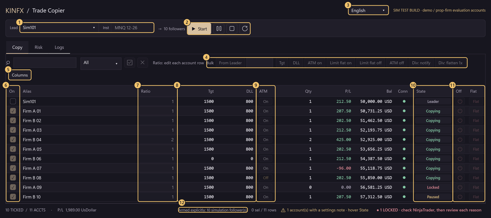
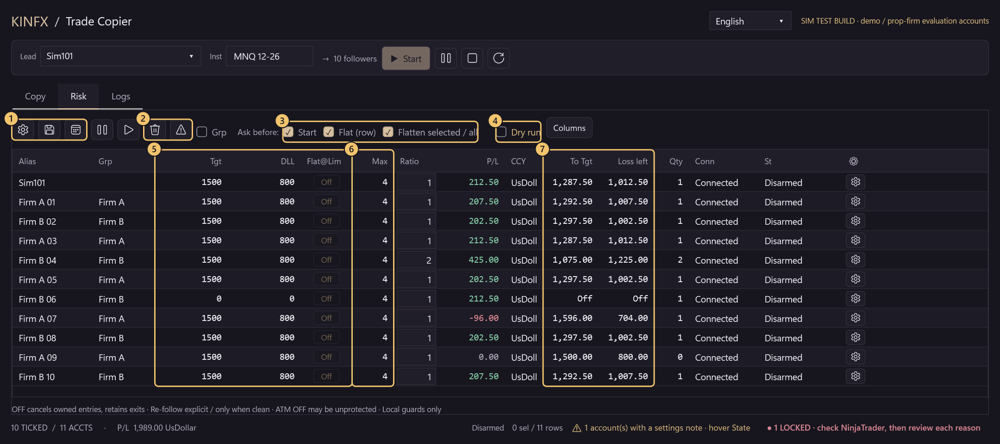

# KINFX Trade Copier

Copy trades from one NinjaTrader 8 leader account to many follower accounts (demo accounts and prop-firm **simulated** / evaluation accounts). Free, open source (MIT), early **source alpha**.

[中文](README.md) · **English** · [日本語](README.ja.md) · [한국어](README.ko.md)

> ⚠️ **TRADING DISABLED in the default build. Funded and live accounts: do not use.** This is a source alpha; the **current source is not accepted**. The opt-in SIM TEST build sends orders to Simulator / Playback accounts and to accounts you confirmed as simulated; that capability is not safety acceptance.

<!-- QUICKSTART:START -->
## Can I use it?

| Account type | Status |
|---|---|
| **Demo / Simulator accounts** | 🟡 **Testing, not accepted.** About **83%** done (weighted historical checklist, not a release-readiness percentage). |
| **Prop-firm simulated / evaluation accounts** | 🟡 **Testing, not accepted.** About **75%** done (same historical checklist). Run on real NinjaTrader 8.1.8.3 with 1 simulator leader and up to 11 operator-attested simulated evaluation accounts (Lucid, Tradeify) on MNQ; this is not release acceptance or firm-rule certification. |
| **Funded or live accounts** | ⛔ **No.** |
<!-- QUICKSTART:END -->

## Interface tour

### Copy tab (while copying)



| # | Where | What it does |
|:-:|---|---|
| 1 | **Lead / Inst** | Pick the leader account and the exact contract (for example `MNQ 12-26`). |
| 2 | **Start / pause / stop / refresh** | **Start** shows a confirmation listing every follower and its Ratio. Pause stops new entries only; Stop waits until flat; refresh re-reads the account list. |
| 3 | **Language** | English, 中文（繁體）, 日本語, 한국어; changeable only while stopped. |
| 4 | **Bulk** | Set Tgt, DLL, ATM, Flat at limit and divergence reaction for the highlighted accounts at once. **From Leader** copies the leader's Tgt / DLL / ATM once; fine-tune each row afterwards. Only while stopped, so it is greyed out here. |
| 5 | **Columns** | Show or hide columns (or right-click a column header); saved for next time. The account-name column is hidden by default and an automatic **Alias** identifies the row (for example `FIRMAB..0001`); hover it for the full name. |
| 6 | **On** | Ticked = follow; unticked = no new entries. |
| 7 | **Ratio** | Per-account multiplier, rounded down. Ratio 2: leader 1 lot, this account 2 lots (still capped by Max). |
| 8 | **Tgt / DLL** | Daily profit target / daily loss limit in account currency, 0 = off. When hit, the account locks and stops copying. |
| 9 | **ATM** | Exit-order mirroring (TP / SL), not a clone of NinjaTrader's native ATM strategy. Off may leave the follower unprotected. |
| 10 | **State** | Leader, Copying, Paused, Locked and so on; hover for the reason. A **Locked** account must be checked in NinjaTrader first; nothing is retried. |
| 11 | **Off / Flat** | **Off** stops following and cancels owned entry orders; position and exits remain. **Flat** closes that one account after you confirm; the others keep copying. |
| 12 | **Footer** | Session state, ticked count, total P/L, settings notes and locked-account count. |

### Risk tab (set while stopped)



| # | Where | What it does |
|:-:|---|---|
| 1 | **Batch risk / save / trading day** | Presets, save settings, trading-day boundary and timezone. |
| 2 | **Flatten selected / all** | Market-close the highlighted accounts or every displayed account; asks first by default. |
| 3 | **Ask before** | Confirmation windows for Start, a row's Flat and Flatten selected / all; untick to skip one. Unlock and risk warnings are always asked. |
| 4 | **Dry run** | Logs `DRY RUN would send ...` and sends nothing. Change it only while stopped. |
| 5 | **Tgt / DLL / Flat@Lim** | Flat at limit = when Tgt or DLL is hit, flatten that account once (never retried); off (default) = only lock and stop copying. |
| 6 | **Max** | Maximum contracts on the exact instrument. |
| 7 | **To Tgt / Loss left** | Room left to the daily target and the daily loss limit. |

**Screenshot provenance:** the real dashboard control rendered in **synthetic DEMO** mode with **fake accounts and numbers**, no connected account, engine or orders; the numbered markers are added for this guide. It is **not NinjaTrader/provider transaction evidence**. [Tour renderer](docs/screenshots/Tour.cs) · [Older gallery renderer](docs/screenshots/Screenshots.cs) · [More tab screenshots](docs/DEVELOPERS.md#dashboard-gallery-and-source)

## Install (Windows + NinjaTrader 8)

**For reviewed testing, not a general release.** Do not trade the current unaccepted build merely because it compiles.

1. Download `KINFXTradeCopier-SIMTEST.zip` from the [v0.2.1-simtest-alpha](https://github.com/Kinfxhk/KINFXTradeCopier/releases/tag/v0.2.1-simtest-alpha) release (exported by NinjaTrader 8 itself; **do not unzip it**; the release notes give its SHA-256).
2. NinjaTrader: *Control Center > Tools > Import > NinjaScript Add-On...*, pick the zip.
3. Answer **Yes** to the "trusted source" question; if it says the file already exists, **Yes** replaces an older copy of this add-on only.
4. Restart NinjaTrader when asked, then open *New > KINFX Trade Copier*.

**Accounts load by themselves.** Every NinjaTrader account is listed and can be ticked; you type no account names. The first time you press **Start** or **Flatten** with an account not yet confirmed as simulated (anything other than Simulator / Playback, e.g. a prop-firm evaluation account), a **risk warning names it**: KINFX cannot tell an evaluation account from a funded or live one. **Yes** = you confirm it is simulated; it is saved to `Documents\NinjaTrader 8\templates\KINFXTradeCopier\sim-allow.txt` and not asked again. **No** = nothing is saved or sent. This warning can never be switched off; delete the line from the file to be asked again.

<details>
<summary>Install from the source</summary>

1. *Code > Download ZIP* on this page, then unzip (or `git clone https://github.com/Kinfxhk/KINFXTradeCopier`).
2. In the unzipped folder run in PowerShell:
   ```powershell
   powershell -ExecutionPolicy Bypass -File scripts\install-simtest.ps1
   ```
   It copies the SIM TEST build into `Documents\NinjaTrader 8\bin\Custom\AddOns`, backs up anything it replaces and touches no account. `-WhatIf` previews, `-Remove` uninstalls.
3. In NinjaTrader: *New > NinjaScript Editor*, press **F5**, wait for *Compile succeeded*. If it errors, stop.

</details>

<details>
<summary>Write sim-allow.txt by hand</summary>

**Create the directory first**: `Documents\NinjaTrader 8\templates\KINFXTradeCopier` (the installer **does not create this directory**), one exact, case-sensitive NinjaTrader Account `Name` per line (not the login or display alias; `= alias` is optional):

```text
# only accounts YOU have confirmed are simulated
MYFIRM-SIM-12345 = Firm A
MYFIRM-SIM-67890 = Firm B
```

A wrong entry can authorize orders to a funded/live account: the file is operator attestation, not provider verification. A hand-edited file is read once at **static initialization**: after editing it, remain stopped and flat, close copier windows, then **restart NinjaTrader**. **Pressing F5 alone** is not a documented hot-reload guarantee. (Answers given in the risk warning take effect at once.)

</details>

## First run

1. *New > KINFX Trade Copier*. This is a rehearsal checklist for the SIM TEST build, **not permission to run the current unaccepted source**.
2. Pick the **Leader** (for example `Sim101`) and exact contract (for example `MNQ 12-26`). In NinjaTrader's native Orders / Positions tabs, confirm the leader and every selected follower are **connected**, with **zero position and no working orders** for that instrument. Start has no adoption or catch-up.
3. Tick **one** follower, Ratio **1**. On the **Risk** tab tick **Dry run**.
4. Press **Start**; read the leader, follower, contract, Ratio and `DRY RUN` confirmation. A small simulated leader order should produce `DRY RUN would send ...` in Logs. Dry run suppresses copier sends, **not orders you place on the leader**. Before stopping, **cancel working leader orders and close the leader position using native NinjaTrader**; verify every account is flat with no working orders. Then press **Stop** and verify the session detaches. If it refuses, stop the rehearsal and investigate; do not force an unlock.
5. **Only after the session is detached** may you untick Dry run; the next Start confirmation no longer shows `DRY RUN` and orders are really sent. **Add followers only while stopped**, recheck all selected accounts are connected and clean, and read a new **Start** confirmation for the full scope.

## Progress

<!-- PROGRESS:START -->
### Progress: Demo / Prop-firm copying

```text
Demo         █████████████████████████░░░░░  83.0%
Prop firm    ██████████████████████░░░░░░░░  74.7%
```

✅ tested on real NinjaTrader · 🟡 offline tests only · ⬜ not yet. Must-haves ✅: Demo 10/14 · Prop 10/15.

Historical checklist evidence, not acceptance of the current candidate. The current candidate is not accepted for trading. Safety P0 / acceptance gates: issue-3, issue-4, issue-7, issue-9. Demo ready=False; Prop ready=False. No funded/live acceptance.

- ✅ Core copy: entry / exit / cancel / modify
- ✅ Per-account Ratio + max-lot cap
- ✅ No lock-up on a flat follower
- ✅ Flat button on every account
- ✅ Flatten selected / all
- ✅ TP / SL mirroring + OCO
- ✅ Auto-lock on danger, no auto-retry
- ✅ Disconnect / reconnect safe
- 🟡 Partial fills handled
- 🟡 Fill frontier before resize (#2)
- 🟡 One stuck account never freezes others (#4)
- ✅ 10-30 accounts on real NT
- ✅ Dashboard (table, bulk edit, lock reasons) _(optional)_
- ✅ Daily target / loss limit per account
- ⬜ Flatten once on divergence (#12) _(optional)_
- ⬜ Adopt existing position (#11) _(optional)_
- ⬜ Self-managed TP/SL (#10) _(optional)_
- ⬜ Restart recovery (#6, shelved) _(optional)_
- ⬜ Installer + reviewed release
- ⬜ Prop-firm rule check (never certified)

Real tests so far: 1 simulator leader, up to 11 **simulated** prop-firm evaluation accounts (5 Lucid, 6 Tradeify), MNQ, Market + Limit + Stop, TP/SL OCO. No funded or live account was ever used. Each tick and its limits: [`docs/PROGRESS.json`](docs/PROGRESS.json). Score = weighted: ✅ 100%, 🟡 50%, design only 10%. Snapshot 2026-10-15, source `8a8deb196fa8`.
<!-- PROGRESS:END -->

The ticks and percentages are a **weighted historical checklist**, **not a release-readiness percentage**. The latest real-NinjaTrader run (2026-10-15 evening) used source `8a8deb196fa8` (SIM TEST build, the one in the release zip); it is test evidence, not acceptance. [Tick evidence and limits](docs/PROGRESS.json) · [Real NT test log](docs/VM-PROGRESS.md) · [Offline results and safety blockers](docs/DEVELOPERS.md)

## Know the limits

- It is a **source alpha**, not an accepted trading build. **Not proved yet:** 20–30 accounts, a real leader disconnect (a Simulator leader reconnects through another connection at once, so the test setup cannot produce one), real partial fills, an ATM start failure, a stalled provider call, a rejected Flatten and restart recovery. Offline compile/tests do not prove these.
- A **Locked** account requires native NinjaTrader investigation. Unlocking is **not** reconciliation of an uncertain engine ledger, a hidden accepted request or a thrown Flatten. The verified-flat recovery gate is missing ([#9](https://github.com/Kinfxhk/KINFXTradeCopier/issues/9); known FAIL `ExplicitManualFlatReconciliationAvailable`). The copier never retries a Flatten or catches up after disconnect.
- NinjaTrader's own Orders and Positions tabs are the truth, not this window. It cannot stop orders you place by hand and cannot guarantee fills.
- Do not remove the safety hold in the default build to "just try it".

Trouble? Open an [issue](https://github.com/Kinfxhk/KINFXTradeCopier/issues) with a **redacted** Logs tab (no account names, no balances).

## More

[Developer and status details](docs/DEVELOPERS.md) · [Do NOT do these](docs/DO-NOT-DO.md) · [Known issues](docs/KNOWN-ISSUES.md) · [Test matrix](docs/TEST-MATRIX.md) · [Roadmap](docs/ROADMAP.md) · [Contributing](CONTRIBUTING.md) · [Security](SECURITY.md)

Developers: the portable checks (`python -B -m unittest discover -s tests -p 'test_*.py' -v`) cover packaging and a separate Python SPEC research; the SPEC is not a C# engine implementation and these checks do not run the copier, a broker or real orders.

## Maintainer links and disclosure

Maintainer: KinFx. Prop-firm rule research, comparison tables, tool links and referral codes: **<https://linktr.ee/kinfx>**

Some links on that page are **affiliate / referral links** (for example prop-firm evaluation codes and partner sign-ups); the maintainer may earn a commission if you use them. They have **no influence on this software**: the code is MIT, contains no referral logic or tracking, and nothing here recommends a firm or a purchase. KinFx is not an SEC/SFC-licensed adviser; content is not investment advice. Most evaluation accounts are simulated. This project is not affiliated with any firm listed there.

## License

[MIT](LICENSE), © 2026 Kinfxhk. Not affiliated with NinjaTrader, FlowBots/Replikanto, any broker or prop firm. No competitor code, vendor DLLs, private account logs or credentials are included. Prop templates in the source are historical editable metadata, not current rules or compliance certification.
