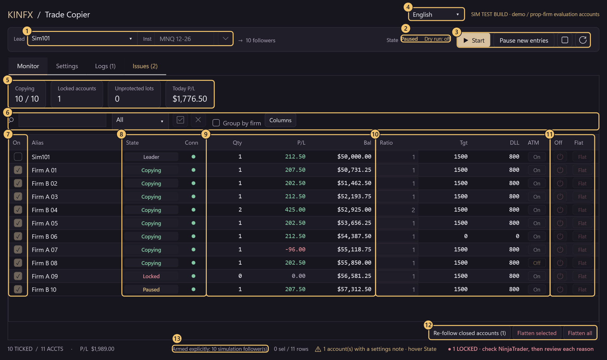
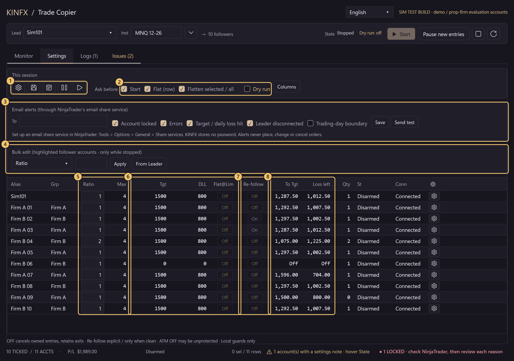
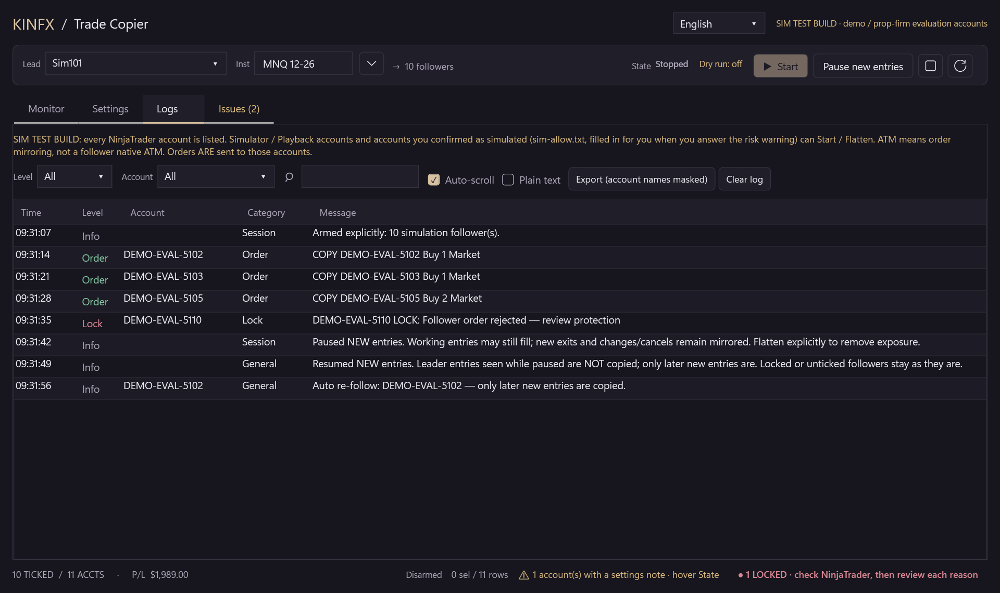
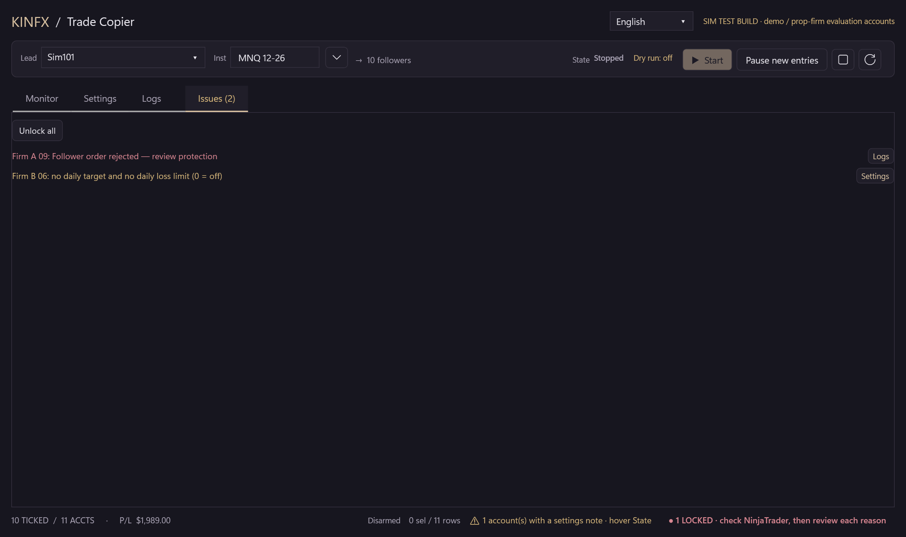

# KINFX Trade Copier

Copy trades from one NinjaTrader 8 leader account to many follower accounts (demo accounts and prop-firm **simulated** / evaluation accounts). Free, open source (MIT), early **source alpha**.

[中文](README.md) · **English** · [日本語](README.ja.md) · [한국어](README.ko.md)

> ⚠️ **TRADING DISABLED in the default build. Funded and live accounts: do not use.** This is a source alpha; the **current source is not accepted**. The opt-in SIM TEST build sends orders to Simulator / Playback accounts and to accounts you confirmed as simulated; that capability is not safety acceptance.

## Risk and disclaimer

Authors and contributors take **no responsibility** for any consequence or loss from using this software. It is **recommended for Demo / Sim only**, and **not recommended** for live or real-money accounts. This is an experimental community alpha and is **not investment advice**.

<!-- QUICKSTART:START -->
## Can I use it?

| Account type | Status |
|---|---|
| **Demo / Simulator accounts** | 🟡 **Testing, not accepted.** About **83%** done (weighted historical checklist, not a release-readiness percentage). |
| **Prop-firm simulated / evaluation accounts** | 🟡 **Testing, not accepted.** About **75%** done (same historical checklist). Run on real NinjaTrader 8.1.8.3 with 1 simulator leader and up to 11 operator-attested simulated evaluation accounts (Lucid, Tradeify) on MNQ; this is not release acceptance or firm-rule certification. |
| **Funded or live accounts** | ⛔ **No.** |
<!-- QUICKSTART:END -->

## Interface tour

One window, four tabs: **Monitor** (watch while copying), **Settings** (change while stopped), **Logs** and **Issues**.

### Monitor tab (while copying)



| # | Where | What it does |
|:-:|---|---|
| 1 | **Lead / Inst** | Pick the leader account and the exact contract (for example `MNQ 12-26`). ▾ lists common index, metal and energy contracts and fills the front month for quarterly index roots. |
| 2 | **State / Dry run** | Always shown: Stopped, Copying or Paused, and whether Dry run is on. |
| 3 | **Start / Pause new entries / stop / refresh** | **Start** shows a confirmation listing every follower and its Ratio. **Pause new entries** stops new entries only; exits and order changes still mirror. After a pause, **Resume new entries** appears; leader entries made while paused are never copied. **Stop** works only when every account is flat with no working orders; otherwise it is refused and stays paused, is not retried later, and Resume new entries is no longer offered. |
| 4 | **Language** | English, 中文（繁體）, 日本語, 한국어; changeable only while stopped. |
| 5 | **Summary cards** | Copying count, locked accounts (click to open the Issues tab), unprotected lots, today's P/L. |
| 6 | **Toolbar** | Search (Ctrl+F), state filter, tick / untick all, group by firm, **Columns** (show or hide columns; saved). The account-name column is hidden by default and an automatic **Alias** identifies the row (for example `FIRMAB..0001`); hover it for the full name. |
| 7 | **On** | Ticked = follow; unticked = no new entries. The leader row is always first. |
| 8 | **State / Conn** | Leader, Copying, Paused, Locked, Closed and so on; hover for the reason. A **Locked** account must be checked in NinjaTrader first; nothing is retried. |
| 9 | **Qty / P/L / Bal** | Position (+ long / − short), session P/L, cash balance with currency symbol. **Drift** compares each follower with the leader: whether the quantity matches its Ratio (`qty±N` = signed difference from the expected position) and how many ticks the average price differs (`adverse` = against you). Display only; it never places an order. |
| 10 | **Ratio / Tgt / DLL / ATM** | Per account. Ratio rounds down; an order that comes out above Max is skipped whole; Tgt / DLL = daily profit target / daily loss limit (0 = off); ATM = exit-order mirroring (TP / SL), not a clone of NinjaTrader's native ATM strategy. |
| 11 | **Off / Flat** | **Off** stops following and cancels owned entry orders; position and exits remain. **Flat** closes that one account after you confirm; the others keep copying. |
| 12 | **Re-follow closed accounts / Flatten selected / Flatten all** | A closed follower (by a copied leader exit or your own Flat) shows "Closed" in State and takes no further entries; this button ticks them again after one confirmation, and only later new entries are copied. The Flatten buttons also work while copying and ask first by default. |
| 13 | **Footer** | Session state, ticked count, total P/L, settings notes and locked-account count. |

### Settings tab (set while stopped)



| # | Where | What it does |
|:-:|---|---|
| 1 | **This session** | Batch risk / presets, save settings, trading-day boundary and timezone (pause new entries at the boundary, or notice only), pause / resume highlighted accounts, and the average-price warning threshold (ticks, display only). |
| 2 | **Ask before / Dry run** | Confirmation windows for Start, a row's Flat and Flatten selected / all; untick to skip one (the Start switch also covers Resume new entries and Re-follow). Unlock and risk warnings are always asked. Dry run only logs `DRY RUN would send ...` and sends nothing. |
| 3 | **Email alerts** | Mail on account lock, errors, target / daily loss hit, leader disconnect and the trading-day boundary. Sent through NinjaTrader's own email share service, so KINFX stores no password; account names are masked and mail is rate-limited. Empty address = off. |
| 4 | **Bulk edit** | Pick a field (Ratio, Max contracts, Daily target, Daily loss, Flat at limit, ATM exit mirroring, On divergence), enter a value and **Apply** it to the highlighted followers; **From Leader** copies the leader's Tgt / DLL / ATM / Flat at limit / On divergence once (to every displayed follower when none is highlighted). Only while stopped. |
| 5 | **Max / Ratio** | Maximum contracts on the exact instrument; copy multiplier. Max counts the account's total: when position + pending entries + the new order would go over it, the new order is skipped whole. A Max still at 1 is outlined as a reminder. |
| 6 | **Tgt / DLL / Flat@Lim** | Flat at limit = when Tgt or DLL is hit, flatten that account once (never retried); off (default) = only lock and stop copying. |
| 7 | **Re-follow** | On = after this account's copied exit completes and the leader is flat, tick it again automatically; only later new entries are copied. An account you flattened yourself is never re-ticked automatically. Off (default) = re-follow by hand on the Monitor tab. |
| 8 | **To Tgt / Loss left** | Room left to the daily target and the daily loss limit. |

### Logs and Issues tabs



**Logs**: coloured by level (Info, Order, Warn, Lock, Error), filter by level, account or text; **Export** masks account names. A daily file `logs/kinfx-yyyyMMdd.log` is written as well.



**Issues**: every lock reason and settings note, each with a button to the Logs or Settings tab. **Unlock all** works only while stopped; after one confirmation it unlocks only accounts that are flat, connected and no longer at a risk limit, and never starts copying.

**Screenshot provenance:** the real dashboard control rendered in **synthetic DEMO** mode with **fake accounts and numbers**, no connected account, engine or orders; the numbered markers are added for this guide. It is **not NinjaTrader/provider transaction evidence**. [Tour renderer](docs/screenshots/Tour.cs) · [Older gallery renderer](docs/screenshots/Screenshots.cs) · [More tab screenshots](docs/DEVELOPERS.md#dashboard-gallery-and-source)

## Install (Windows + NinjaTrader 8)

**For reviewed testing, not a general release.** Do not trade the current unaccepted build merely because it compiles.

### Import the NinjaTrader zip (recommended)

1. Download `KINFXTradeCopier-SIMTEST.zip` from the [v0.3.0-simtest-alpha](https://github.com/Kinfxhk/KINFXTradeCopier/releases/tag/v0.3.0-simtest-alpha) release (exported by NinjaTrader 8 itself; **do not unzip it**; the release notes give its SHA-256). It is the interface shown on this page.
2. NinjaTrader: *Control Center > Tools > Import > NinjaScript Add-On...*, pick the zip.
3. Answer **Yes** to the "trusted source" question; if it says the file already exists, **Yes** replaces an older copy of this add-on only.
4. Restart NinjaTrader when asked, then open *New > KINFX Trade Copier*.

> This zip was compiled and its Dashboard opened on real NinjaTrader, but Resume new entries, Re-follow and email alerts have not been run after Start yet (see "Know the limits").

<details>
<summary>Install from the source</summary>

1. *Code > Download ZIP* on this page, then unzip (or `git clone https://github.com/Kinfxhk/KINFXTradeCopier`).
2. In the unzipped folder run in PowerShell:
   ```powershell
   powershell -ExecutionPolicy Bypass -File scripts\install-simtest.ps1
   ```
   It copies the SIM TEST build into `Documents\NinjaTrader 8\bin\Custom\AddOns`, backs up anything it replaces (including an older copy imported from the zip) to `Documents\NinjaTrader 8\KINFX-backups` and touches no account. If another copy of this add-on exists elsewhere, it stops and names the path; move that copy out first. `-WhatIf` previews, `-Remove` uninstalls.
3. In NinjaTrader: *New > NinjaScript Editor*, press **F5**, wait for *Compile succeeded*. If it errors, stop.
4. Open *New > KINFX Trade Copier*.

</details>

**Accounts load by themselves.** Every NinjaTrader account is listed and can be ticked; you type no account names. The first time you press **Start** or **Flatten** with an account not yet confirmed as simulated (anything other than Simulator / Playback, e.g. a prop-firm evaluation account), a **risk warning names it**: KINFX cannot tell an evaluation account from a funded or live one. **Yes** = you confirm it is simulated; it is saved to `Documents\NinjaTrader 8\templates\KINFXTradeCopier\sim-allow.txt` and not asked again. **No** = nothing is saved or sent. This warning can never be switched off; to be asked again, delete the line from the file and restart NinjaTrader.

<details>
<summary>Write sim-allow.txt by hand</summary>

**Create the directory first**: `Documents\NinjaTrader 8\templates\KINFXTradeCopier` (the installer **does not create this directory**), one exact, case-sensitive NinjaTrader Account `Name` per line (not the login or display alias; `= alias` is optional):

```text
# only accounts YOU have confirmed are simulated
MYFIRM-SIM-12345 = Firm A
MYFIRM-SIM-67890 = Firm B
```

A wrong entry can authorize orders to a funded/live account: the file is operator attestation, not provider verification. A hand-edited file is read once at **static initialization**: after editing it, remain stopped and flat, close copier windows, then **restart NinjaTrader**. **Pressing F5 alone** is not a documented hot-reload guarantee. (Answers given in the risk warning take effect at once.)

</details>

## First run

1. *New > KINFX Trade Copier*. This is a rehearsal checklist for the SIM TEST build, **not permission to run the current unaccepted source**.
2. On the **Monitor** tab pick the **Leader** (for example `Sim101`) and exact contract (for example `MNQ 12-26`, or pick it from ▾). In NinjaTrader's native Orders / Positions tabs, confirm the leader and every selected follower are **connected**, with **zero position and no working orders** for that instrument. Start has no adoption or catch-up.
3. Tick **one** follower. On the **Settings** tab set its Ratio to **1** and Max to **1**, and tick **Dry run**; the header then shows "Dry run: on".
4. Press **Start**; read the leader, follower, contract, Ratio and `DRY RUN` confirmation. A small simulated leader order should produce `DRY RUN would send ...` on the **Logs** tab. Dry run suppresses copier sends, **not orders you place on the leader**. You can try **Pause new entries** and then **Resume new entries**: leader entries made while paused are not copied. Before stopping, **cancel working leader orders and close the leader position using native NinjaTrader**; verify every account is flat with no working orders. Then press **Stop** and verify the session detaches. If it refuses, stop the rehearsal and investigate; do not force an unlock.
5. **Only after the session is detached** may you untick Dry run; the next Start confirmation no longer shows `DRY RUN` and orders are really sent. **Add followers only while stopped**, recheck all selected accounts are connected and clean, and read a new **Start** confirmation for the full scope.
6. A follower closed by a copied leader exit shows "Closed" in State and does not take the next entry. Press **Re-follow closed accounts** on the Monitor tab, or turn on **Re-follow** (automatic; not for an account you flattened yourself) for that account on the Settings tab. Both copy only later new entries; nothing is caught up.

## Where settings are kept

Everything is in `Documents\NinjaTrader 8\templates\KINFXTradeCopier`. Removing the add-on does not delete these files.

| File | Holds |
|---|---|
| `sim-allow.txt` | Accounts confirmed as simulated (written when you answer Yes to the risk warning). |
| `<window id>.xml`, `last-workspace.xml` | Per-account Ratio, Max, Tgt, DLL, ATM, Re-follow and so on, plus the trading-day boundary. |
| `risk-latches.xml` | Locks. They survive a restart; unlock them on the Issues tab. |
| `columns.txt` | Which columns are shown; delete it to get the default columns back. |
| `confirm-prefs.txt` | The "Ask before" switches. |
| `notify.txt` | Email alert address and event kinds (no password). |
| `language.txt`, `instruments-recent.txt` | Interface language; recently used contracts. |
| `display.json` | Average-price drift warning threshold (ticks). |
| `logs\kinfx-yyyyMMdd.log` | Daily log. `logs\export-*.txt` are exported logs with account names masked. |

## Email alerts

1. NinjaTrader: *Tools > Options > General > Share services*, add an email share service. NinjaTrader keeps the mail account and password; KINFX never reads or stores them.
2. On the KINFX **Settings** tab, under **Email alerts**, enter the address, tick the events you want and press **Save**.
3. Press **Send test** and check the inbox; if nothing arrives, check NinjaTrader's *Log* tab.

With no address set, nothing is ever sent. Once an address is set, account lock, errors, target / daily loss hit and leader disconnect are on by default; the trading-day boundary is off by default. At most one mail per event kind and account every 10 minutes and 20 mails per hour in total; the rest are counted in the next mail. Account names in mail are masked. Alerts never place, change or cancel orders. **Mail delivery is not yet verified on real NinjaTrader.**

## Progress

<!-- PROGRESS:START -->
### Progress: Demo / Prop-firm copying

```text
Demo         █████████████████████████░░░░░  83.0%
Prop firm    ██████████████████████░░░░░░░░  74.7%
```

✅ tested on real NinjaTrader · 🟡 offline tests only · ⬜ not yet. Must-haves ✅: Demo 10/14 · Prop 10/15.

Historical checklist evidence, not acceptance of the current candidate. The current candidate is not accepted for trading. Safety P0 / acceptance gates: issue-3, issue-4, issue-7, issue-9. Demo ready=False; Prop ready=False. No funded/live acceptance.

- ✅ Core copy: entry / exit / cancel / modify
- ✅ Per-account Ratio + max-lot cap
- ✅ No lock-up on a flat follower
- ✅ Flat button on every account
- ✅ Flatten selected / all
- ✅ TP / SL mirroring + OCO
- ✅ Auto-lock on danger, no auto-retry
- ✅ Disconnect / reconnect safe
- 🟡 Partial fills handled
- 🟡 Fill frontier before resize (#2)
- 🟡 One stuck account never freezes others (#4)
- ✅ 10-11 accounts on real NT (20-30 not yet)
- ✅ Dashboard (table, bulk edit, lock reasons) _(optional)_
- ✅ Daily target / loss limit per account
- ⬜ Flatten once on divergence (#12) _(optional)_
- ⬜ Adopt existing position (#11) _(optional)_
- ⬜ Self-managed TP/SL (#10) _(optional)_
- ⬜ Restart recovery (#6, shelved) _(optional)_
- ⬜ Installer + reviewed release
- ⬜ Prop-firm rule check (never certified)

Real tests so far: 1 simulator leader, up to 11 **simulated** prop-firm evaluation accounts (5 Lucid, 6 Tradeify), MNQ, Market + Limit + Stop, TP/SL OCO. No funded or live account was ever used. Each tick and its limits: [`docs/PROGRESS.json`](docs/PROGRESS.json). Score = weighted: ✅ 100%, 🟡 50%, design only 10%. Snapshot 2026-10-15, source `8a8deb196fa8`.
<!-- PROGRESS:END -->

The ticks and percentages are a **weighted historical checklist**, **not a release-readiness percentage**. The latest real-NinjaTrader trading run (2026-10-15 evening) used source `8a8deb196fa8` (SIM TEST build, the one in the older v0.2.0 zip); it is test evidence, not acceptance. The current source's interface was checked page by page on real NinjaTrader in all four languages on 2026-10-17, and the v0.3.0 zip's file compiled and opened there (Start not pressed, no order sent); Resume new entries, Re-follow and email alerts have offline tests only. [Tick evidence and limits](docs/PROGRESS.json) · [Real NT test log](docs/VM-PROGRESS.md) · [Offline results and safety blockers](docs/DEVELOPERS.md)

## Know the limits

- It is a **source alpha**, not an accepted trading build. **Not proved yet:** 20–30 accounts, a real leader disconnect (a Simulator leader reconnects through another connection at once, so the test setup cannot produce one), real partial fills, an ATM start failure, a stalled provider call, a rejected Flatten and restart recovery. Offline compile/tests do not prove these.
- **Offline tests only:** Resume new entries, Re-follow closed accounts (including automatic re-follow), the trading-day boundary "notice only" mode and email alerts have not been run after Start on real NinjaTrader.
- Max defaults to 1 and counts the account's total on the instrument (position + pending entries + the new order). Over Max, the new order is **skipped entirely**, not reduced to Max; an add-on order too. The Settings tab outlines a Max that is still 1.
- A **Locked** account requires native NinjaTrader investigation. Unlocking is **not** reconciliation of an uncertain engine ledger, a hidden accepted request or a thrown Flatten. The verified-flat recovery gate is missing ([#9](https://github.com/Kinfxhk/KINFXTradeCopier/issues/9); known FAIL `ExplicitManualFlatReconciliationAvailable`). The copier never retries a Flatten or catches up after disconnect.
- NinjaTrader's own Orders and Positions tabs are the truth, not this window. It cannot stop orders you place by hand and cannot guarantee fills.
- Do not remove the safety hold in the default build to "just try it".

Trouble? Open an [issue](https://github.com/Kinfxhk/KINFXTradeCopier/issues) with a **redacted** log (**Export** on the Logs tab masks account names; leave balances out).

## More

[Developer and status details](docs/DEVELOPERS.md) · [Do NOT do these](docs/DO-NOT-DO.md) · [Known issues](docs/KNOWN-ISSUES.md) · [Test matrix](docs/TEST-MATRIX.md) · [Roadmap](docs/ROADMAP.md) · [Contributing](CONTRIBUTING.md) · [Security](SECURITY.md)

Developers: the portable checks (`python -B -m unittest discover -s tests -p 'test_*.py' -v`) cover packaging and a separate Python SPEC research; the SPEC is not a C# engine implementation and these checks do not run the copier, a broker or real orders.

## Maintainer links and disclosure

Maintainer: KinFx. Prop-firm rule research, comparison tables, tool links and referral codes: **<https://linktr.ee/kinfx>**

Some links on that page are **affiliate / referral links** (for example prop-firm evaluation codes and partner sign-ups); the maintainer may earn a commission if you use them. They have **no influence on this software**: the code is MIT, contains no referral logic or tracking, and nothing here recommends a firm or a purchase. KinFx is not an SEC/SFC-licensed adviser; content is not investment advice. Most evaluation accounts are simulated. This project is not affiliated with any firm listed there.

## License

[MIT](LICENSE), © 2026 Kinfxhk. Not affiliated with NinjaTrader, FlowBots/Replikanto, any broker or prop firm. No competitor code, vendor DLLs, private account logs or credentials are included. Prop templates in the source are historical editable metadata, not current rules or compliance certification.
