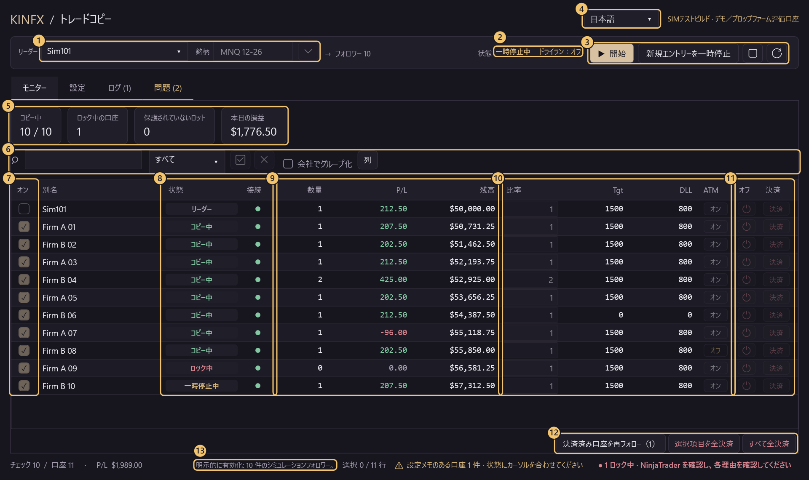
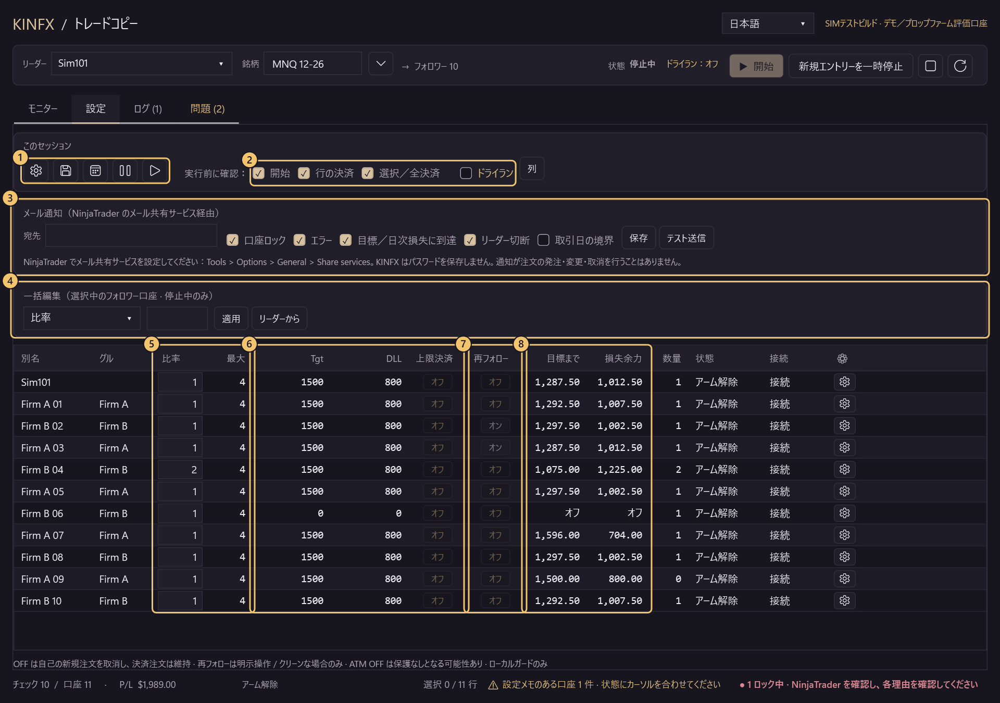
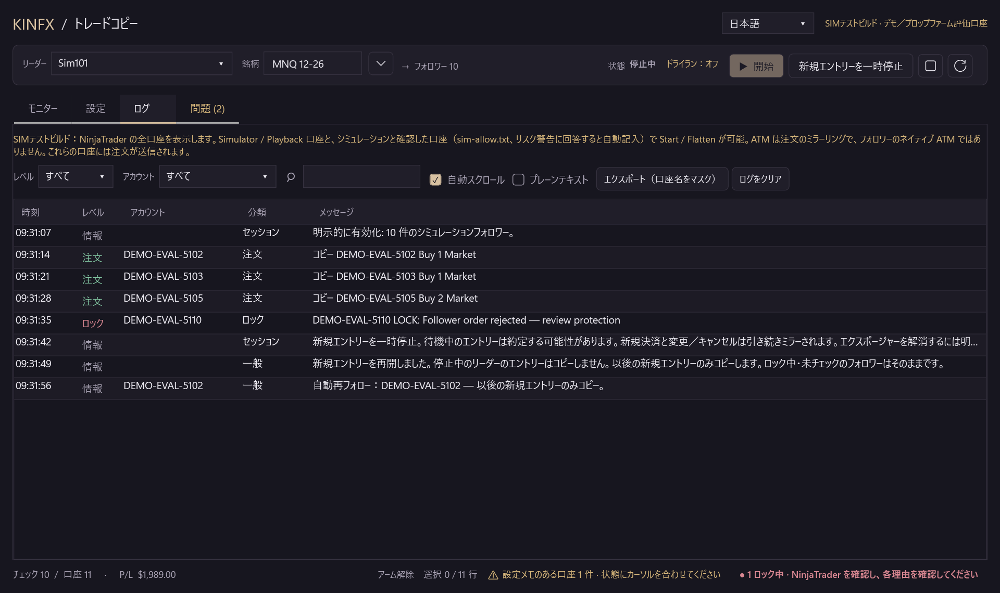
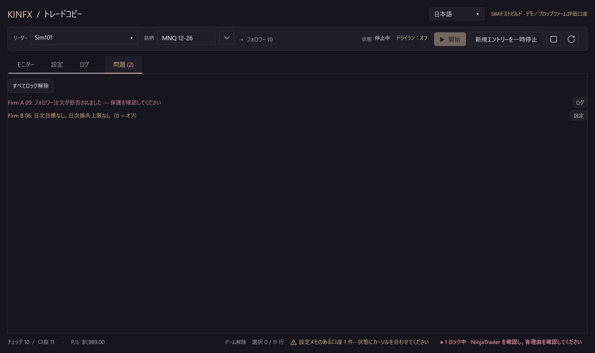

# KINFX Trade Copier

NinjaTrader 8 で、1 つのリーダー口座の取引を複数のフォロワー口座（Demo 口座と Prop Firm の**シミュレーション**／評価口座）へコピーします。無料、オープンソース（MIT）、初期の**ソース alpha**です。

[中文](README.md) · [English](README.en.md) · **日本語** · [한국어](README.ko.md)

> ⚠️ **既定ビルドでは取引が無効です。Funded／ライブ口座：使用禁止。** これはソース alpha であり、**現在のソースは受け入れられていません**。任意で使う SIM TEST ビルドは Simulator／Playback 口座と、あなたがシミュレーションだと確認した口座へ注文を送ります。その能力は安全受入ではありません。

## リスクと免責

作者および貢献者は、本ソフトウェアの使用によって生じるいかなる結果または損失についても**責任を負いません**。**推奨するのは Demo／Sim のみ**であり、ライブ口座や実資金の口座は**推奨しません**。これは実験的なコミュニティ alpha であり、**投資助言ではありません**。

<!-- QUICKSTART:START -->
## 使えますか？

| 口座の種類 | 状態 |
|---|---|
| **Demo／シミュレーター口座** | 🟡 **テスト中、未受入。** 完了度は約 **83%**（加重した過去のチェックリストであり、リリース準備の割合ではありません）。 |
| **Prop Firm のシミュレーション／評価口座** | 🟡 **テスト中、未受入。** 完了度は約 **75%**（同じ過去のチェックリスト）。実機 NinjaTrader 8.1.8.3 で、シミュレーターのリーダー 1 と、操作者が確認したシミュレーション評価口座最大 11（Lucid、Tradeify）を使い MNQ で実行しました。リリース受入でも、ファームのルール認証でもありません。 |
| **Funded／ライブ口座** | ⛔ **禁止。** |
<!-- QUICKSTART:END -->

## 画面ガイド

1 つのウィンドウに 4 つのタブがあります：**モニター**（コピー中に見る）、**設定**（停止中に変更）、**ログ**、**問題**。

### モニタータブ（コピー中）



| # | 場所 | 内容 |
|:-:|---|---|
| 1 | **リーダー／銘柄** | リーダー口座と正確な限月（例：`MNQ 12-26`）を選びます。▾ は主な指数・金属・エネルギーの銘柄を一覧し、四半期限月の指数は期近を入力します。 |
| 2 | **状態／ドライラン** | 停止中・コピー中・一時停止中と、ドライランのオン／オフを常に表示します。 |
| 3 | **開始／新規エントリーを一時停止／停止／更新** | **開始**の前に、すべてのフォロワーと比率を示す確認が出ます。**新規エントリーを一時停止**は新規エントリーだけを止め、決済と注文変更は引き続きミラーします。一時停止後は**新規エントリーを再開**が表示されます。一時停止中のリーダーのエントリーはコピーしません。**停止**はすべての口座がフラットで未約定注文がないときのみ有効です。そうでなければ拒否されて一時停止のままとなり、後で自動再試行はせず、新規エントリーの再開もできなくなります。 |
| 4 | **言語** | English、中文（繁體）、日本語、한국어。停止中のみ変更できます。 |
| 5 | **サマリーカード** | コピー中の口座数、ロック中の口座（クリックで「問題」タブを開く）、保護されていないロット、本日の損益。 |
| 6 | **ツールバー** | 検索（Ctrl+F）、状態の絞り込み、すべて選択／解除、会社でグループ化、**列**（列の表示／非表示、保存されます）。口座名の列は既定で非表示で、自動の**別名**（例：`FIRMAB..0001`）で口座を区別します。カーソルを合わせると正式名を表示します。 |
| 7 | **オン** | チェック＝フォロー、チェックを外す＝新規エントリー停止。リーダーの行は常に先頭です。 |
| 8 | **状態／接続** | リーダー、コピー中、一時停止中、ロック中、決済済みなど。カーソルを合わせると理由を表示します。**ロック中**の口座はまず NinjaTrader で確認してください。自動で再試行はしません。 |
| 9 | **数量／P/L／残高** | ポジション（＋買い／−売り）、このセッションの損益、通貨記号付きの現金残高。 |
| 10 | **比率／Tgt／DLL／ATM** | 口座ごとの設定。比率は切り捨てで、最大を超える注文は丸ごと見送られます。Tgt／DLL＝日次利益目標／日次損失上限（0＝オフ）。ATM＝決済注文のミラー（利確／損切り）であり、NinjaTrader 標準の ATM 戦略のコピーではありません。 |
| 11 | **オフ／決済** | **オフ**＝フォローを止め、自分のエントリー注文を取り消します。ポジションと決済注文は残ります。**決済**＝確認後、その 1 口座だけを決済し、他の口座はコピーを続けます。 |
| 12 | **決済済み口座を再フォロー／選択項目を全決済／すべて全決済** | 決済済みのフォロワー（リーダーの決済をコピー、または自分で決済）は状態に「決済済み」と表示され、次のエントリーは受けません。このボタンで確認後に再びチェックし、以後の新規エントリーだけをコピーします。全決済ボタンはコピー中も使え、既定では確認が出ます。 |
| 13 | **フッター** | セッション状態、チェック数、合計損益、設定メモ、ロック中の口座数。 |

### 設定タブ（停止中に設定）



| # | 場所 | 内容 |
|:-:|---|---|
| 1 | **このセッション** | 一括リスク／プリセット、設定を保存、取引日の境界とタイムゾーン（境界で新規エントリーを一時停止するか、通知のみにするか）、選択中の口座の一時停止／再開。 |
| 2 | **実行前に確認／ドライラン** | 開始、行の決済、選択／全決済の確認ウィンドウ。チェックを外すと省略します（「開始」は新規エントリーの再開と再フォローにも適用）。ロック解除とリスク警告は必ず確認します。ドライランは `DRY RUN would send ...` を記録するだけで、何も送信しません。 |
| 3 | **メール通知** | 口座ロック、エラー、目標／日次損失に到達、リーダー切断、取引日の境界でメールを送ります。NinjaTrader 自身のメール共有サービスで送るため、KINFX はパスワードを保存しません。口座名はマスクされ、送信数に上限があります。宛先が空欄ならオフです。 |
| 4 | **一括編集** | 項目（比率、最大枚数、日次目標、日次損失、上限で全決済、ATM 決済注文ミラーリング、ダイバージェンス時）を選び、値を入力して**適用**すると、選択中のフォロワーに反映します。**リーダーから**はリーダーの Tgt／DLL／ATM／上限決済／ダイバージェンス時を 1 回だけコピーします（選択がなければ表示中のすべてのフォロワー）。停止中のみ。 |
| 5 | **最大／比率** | 同一銘柄の最大契約数と、コピーの倍率。最大は口座の合計で数えます。ポジション＋未約定のエントリー＋新しい注文が最大を超えると、新しい注文は丸ごと見送られます。1 のままの最大は枠線で知らせます。 |
| 6 | **Tgt／DLL／上限決済** | 上限決済＝Tgt または DLL に達したとき、その口座を 1 回だけ決済します（再試行なし）。オフ（既定）＝ロックしてコピーを止めるだけです。 |
| 7 | **再フォロー** | オン＝この口座のコピーした決済が完了し、リーダーがフラットになったら自動で再びチェックし、以後の新規エントリーだけをコピーします。自分で決済した口座は自動では再チェックしません。オフ（既定）＝モニタータブで手動で再フォロー。 |
| 8 | **目標まで／損失余力** | 日次目標と日次損失上限までの残り。 |

### ログタブと問題タブ



**ログ**：レベル（情報、注文、警告、ロック、エラー）ごとに色分けし、レベル・口座・文字で絞り込めます。**エクスポート**は口座名をマスクします。日ごとのファイル `logs/kinfx-yyyyMMdd.log` も書き出します。



**問題**：すべてのロック理由と設定メモを一覧し、それぞれにログまたは設定へ移るボタンがあります。**すべてロック解除**は停止中のみ使え、1 回の確認のあと、フラットで接続済み、かつリスク上限に達していない口座だけを解除し、コピーは開始しません。

**スクリーンショットの出所：** 実際のダッシュボードコントロールを **合成 DEMO** モードで描画し、**架空の口座と数値**を示します。接続された口座、エンジン、注文はありません。番号は説明のために付けたものです。これは **NinjaTrader／provider の取引証拠ではありません**。[画面ガイドの描画ソース](docs/screenshots/Tour.cs) · [旧ギャラリーの描画ソース](docs/screenshots/Screenshots.cs) · [他のタブの画像](docs/DEVELOPERS.md#dashboard-gallery-and-source)

## インストール（Windows ＋ NinjaTrader 8）

**レビュー済みのテスト用であり、一般公開ではありません。** コンパイルできたという理由だけで、現在の未受入の版で取引しないでください。

> [v0.2.1-simtest-alpha](https://github.com/Kinfxhk/KINFXTradeCopier/releases/tag/v0.2.1-simtest-alpha) の zip は**旧画面**（コピー／リスク／ログの 3 タブ）です。このページのモニター／設定／ログ／問題タブ、新規エントリーの再開、再フォロー、メール通知は含みません。新しい画面は今のところソースからのみインストールできます。新しい zip は実機 NinjaTrader で確認した後に公開します。

### ソースからインストール（このページの画面）

1. このページの *Code > Download ZIP* を解凍します（または `git clone https://github.com/Kinfxhk/KINFXTradeCopier`）。
2. 解凍したフォルダーで PowerShell を実行します：
   ```powershell
   powershell -ExecutionPolicy Bypass -File scripts\install-simtest.ps1
   ```
   SIM TEST ビルドを `Documents\NinjaTrader 8\bin\Custom\AddOns` にコピーし、置き換える前（zip で入れた旧版を含む）に `Documents\NinjaTrader 8\KINFX-backups` へバックアップします。口座は操作しません。別の場所にもう 1 つこのアドオンがあると、停止してそのパスを示します。先に移動してください。`-WhatIf` はプレビュー、`-Remove` は削除です。
3. NinjaTrader で *New > NinjaScript Editor* を開き、**F5** を押し、*Compile succeeded* を待ちます。エラーなら中止します。
4. *New > KINFX Trade Copier* を開きます。

<details>
<summary>リリースの zip をインポート（旧画面）</summary>

1. [v0.2.1-simtest-alpha](https://github.com/Kinfxhk/KINFXTradeCopier/releases/tag/v0.2.1-simtest-alpha) から `KINFXTradeCopier-SIMTEST.zip` をダウンロードします（NinjaTrader 8 自身が書き出したもの。**解凍しません**。SHA-256 はリリースノートにあります）。
2. NinjaTrader：*Control Center > Tools > Import > NinjaScript Add-On...* で zip を選びます。
3. 信頼できる提供元かを聞かれたら **Yes**。ファイルが既にあると言われたら、**Yes** はこのアドオンの旧版だけを置き換えます。
4. 求められたら NinjaTrader を再起動し、*New > KINFX Trade Copier* を開きます。

</details>

**口座は自動で読み込まれます。** すべての NinjaTrader 口座が一覧され、チェックできます。口座名を入力する必要はありません。Simulator／Playback 以外で、まだシミュレーションと確認していない口座（例：Prop Firm の評価口座）に初めて**開始**または**決済**を押すと、**その口座名を示すリスク警告**が出ます。KINFX は評価口座と funded／ライブ口座を区別できません。**はい**＝シミュレーション口座だと確認したことになり、`Documents\NinjaTrader 8\templates\KINFXTradeCopier\sim-allow.txt` に保存され、以後は尋ねません。**いいえ**＝保存も送信もしません。この警告はオフにできません。再び尋ねさせるには、ファイルからその行を削除して NinjaTrader を再起動します。

<details>
<summary>sim-allow.txt を手で書く</summary>

**先にフォルダーを作成**してください：`Documents\NinjaTrader 8\templates\KINFXTradeCopier`（インストーラーは**このフォルダーは作成しません**）。1 行に 1 つの NinjaTrader Account `Name`。大文字小文字を区別し、完全一致が必要です。ログイン名や表示別名は不可です（`= 別名` は任意）：

```text
# 操作者が模擬だと確認した口座だけ
MYFIRM-SIM-12345 = Firm A
MYFIRM-SIM-67890 = Firm B
```

誤った名前は funded／ライブ口座への注文を許可し得ます。ファイルは操作者の申告であり、provider の検証ではありません。手で編集したファイルは**静的初期化**のときに読まれます。編集後は停止かつフラットのまま copier のウィンドウを閉じ、**NinjaTrader を再起動**してください。**F5 だけでは**即時の再読込を保証しません。（リスク警告での回答は直ちに有効になります。）

</details>

## 初回の使い方

1. *New > KINFX Trade Copier*。これは SIM TEST ビルドのリハーサル一覧であり、**現在の未受入ソースで取引してよいという意味ではありません**。
2. **モニター**タブで**リーダー**（例：`Sim101`）と正確な限月（例：`MNQ 12-26`、▾ からも選べます）を選びます。NinjaTrader 標準の Orders／Positions タブで、リーダーと選んだすべてのフォロワーが**接続済み**であり、その銘柄の**ポジションはゼロで、未約定の注文はありません**ことを確認します。開始時に既存ポジションの引き継ぎや取りこぼしの補充はしません。
3. フォロワーは **1 つだけ**チェックします。**設定**タブでその口座の比率を **1**、最大を **1** にし、**ドライラン**をオンにします。上部に「ドライラン：オン」と表示されます。
4. **開始**を押し、リーダー、フォロワー、限月、比率、`DRY RUN` の確認を読みます。リーダーで小さい模擬注文を出すと、**ログ**タブに `DRY RUN would send ...` が出ます。ドライランが止めるのは copier の送信だけで、**リーダーに自分で出す注文は止めません**。**新規エントリーを一時停止**のあと**新規エントリーを再開**も試せます。一時停止中のリーダーのエントリーはコピーしません。停止する前に、**NinjaTrader の標準機能で Leader の未約定注文を取り消し、Leader のポジションを決済してから**、すべての口座がフラットで未約定注文がないことを確認します。それから **Stop**（停止）を押し、セッションが切り離されたことを確認します。拒否されたらリハーサルを中止して調査し、無理にロック解除しないでください。
5. **セッションの接続が解除された後にのみ**ドライランを外せます。その後の Start 確認には `DRY RUN` が表示されず、注文は実際に送信されます。**停止中にのみフォロワーを追加**し、選んだ全口座が接続済みでクリーンであることを再確認し、範囲全体を含む新しい **Start** 確認を読みます。
6. リーダーの決済をコピーして決済されたフォロワーは状態が「決済済み」となり、次のエントリーは受けません。モニタータブの**決済済み口座を再フォロー**を押すか、設定タブでその口座の**再フォロー**（自動。自分で決済した口座は対象外）をオンにします。どちらも以後の新規エントリーだけをコピーし、補充はしません。

## 設定ファイルの場所

すべて `Documents\NinjaTrader 8\templates\KINFXTradeCopier` にあります。アドオンを削除してもこれらのファイルは消えません。

| ファイル | 内容 |
|---|---|
| `sim-allow.txt` | シミュレーションと確認した口座（リスク警告で「はい」を押すと書き込み）。 |
| `<ウィンドウ ID>.xml`、`last-workspace.xml` | 口座ごとの比率、最大、Tgt、DLL、ATM、再フォローなどと、取引日の境界。 |
| `risk-latches.xml` | ロックの記録。再起動後も残ります。「問題」タブで解除します。 |
| `columns.txt` | 列の表示設定。削除すると既定の列に戻ります。 |
| `confirm-prefs.txt` | 「実行前に確認」の設定。 |
| `notify.txt` | メール通知の宛先とイベントの種類（パスワードなし）。 |
| `language.txt`、`instruments-recent.txt` | 画面の言語、最近使った銘柄。 |
| `logs\kinfx-yyyyMMdd.log` | 日ごとのログ。`logs\export-*.txt` はエクスポートしたログ（口座名はマスク済み）。 |

## メール通知

1. NinjaTrader：*Tools > Options > General > Share services* でメール共有サービスを追加します。メールアカウントとパスワードは NinjaTrader が保持し、KINFX は読み取りも保存もしません。
2. KINFX の**設定**タブの**メール通知**で宛先を入力し、通知するイベントにチェックして**保存**を押します。
3. **テスト送信**を押して受信箱を確認します。届かない場合は NinjaTrader の *Log* タブを確認します。

宛先が空欄なら何も送りません。宛先を入れると、既定では口座ロック、エラー、目標／日次損失に到達、リーダー切断が通知されます。取引日の境界は既定でオフです。同じ口座・同じ種類のイベントは 10 分に 1 通まで、全体で 1 時間に 20 通までです。残りは次のメールで件数を伝えます。メール内の口座名はマスクされます。通知が注文を出したり、変更・取消したりすることはありません。**メールの配信は実機 NinjaTrader でまだ確認していません。**

## 進捗

<!-- PROGRESS:START -->
### 進捗：Demo／Prop Firm コピー

```text
Demo         █████████████████████████░░░░░  83.0%
Prop firm    ██████████████████████░░░░░░░░  74.7%
```

✅ 実際の NinjaTrader で検証済み · 🟡 オフラインテストのみ · ⬜ 未実施。必須項目 ✅：Demo 10/14 · Prop 10/15。

過去のチェックリストの証拠であり、現在の候補を受け入れたものではありません。現在の候補は取引について受け入れられていません。安全 P0／受入ゲート：issue-3, issue-4, issue-7, issue-9。Demo ready=False；Prop ready=False。funded／ライブの受入はありません。

- ✅ コアコピー：エントリー／決済／取消／変更
- ✅ 口座ごとの比率＋最大枚数
- ✅ 無ポジションのフォロワーはロックしない
- ✅ 各口座の決済ボタン
- ✅ 選択／全口座の Flatten
- ✅ TP／SL ミラー＋OCO
- ✅ 危険時は自動ロック、自動再試行なし
- ✅ 切断／再接続は安全
- 🟡 部分約定に対応
- 🟡 数量変更前の約定一致 (#2)
- 🟡 1口座の停滞が他口座を止めない (#4)
- ✅ 実機 NT で 10–11 口座（20–30 は未実施）
- ✅ ダッシュボード（表、一括編集、ロック理由） _（任意）_
- ✅ 口座ごとの日次目標／損失上限
- ⬜ 乖離時に一度だけ Flatten (#12) _（任意）_
- ⬜ 既存ポジションの引き継ぎ (#11) _（任意）_
- ⬜ 口座ごとの自己管理 TP/SL (#10) _（任意）_
- ⬜ 再起動からの復旧（#6、保留） _（任意）_
- ⬜ インストーラー＋レビュー後のリリース
- ⬜ Prop Firm ルール確認（本ソフトは認証しない）

これまでの実機テスト：シミュレーターのリーダー 1、最大 11 の**シミュレーション** Prop Firm 評価口座（Lucid 5、Tradeify 6）、MNQ、成行＋指値＋逆指値、TP/SL OCO。funded またはライブ口座は一度も使用していません。各項目と制限：[`docs/PROGRESS.json`](docs/PROGRESS.json)。配点は加重：✅ 100%、🟡 50%、設計のみ 10%。スナップショット 2026-10-15、ソース `8a8deb196fa8`。
<!-- PROGRESS:END -->

チェックと百分率は**加重した過去のチェックリスト**であり、**リリース準備の割合ではありません**。直近の実機 NinjaTrader での取引テスト（2026-10-15 夜）はソース `8a8deb196fa8`（SIM TEST ビルド、リリースの zip と同じ）で、テスト証拠であり受入ではありません。現在のソースの画面は 2026-10-17 に実機 NinjaTrader で 4 言語すべてをページごとに確認しました（開始は押さず、注文は送っていません）。新規エントリーの再開、再フォロー、メール通知はオフラインテストのみです。[各項目の証拠と制限](docs/PROGRESS.json) · [実機 NT テスト記録](docs/VM-PROGRESS.md) · [オフライン結果と安全上の障害](docs/DEVELOPERS.md)

## 制限

- これは**ソース alpha**であり、受け入れられた取引ビルドではありません。**まだ証明されていません：**20–30 口座、実際のリーダー切断（Simulator のリーダーは別の接続ですぐ再接続するため、テスト環境では再現できません）、実際の部分約定、ATM の開始失敗、停滞した provider 呼び出し、拒否された Flatten、再起動からの復旧。オフラインのコンパイル／テストはこれらを証明しません。
- **オフラインテストのみ：**新規エントリーの再開、決済済み口座の再フォロー（自動を含む）、取引日の境界の「通知のみ」モード、メール通知は、実機 NinjaTrader で開始後にまだ確認していません。
- 最大は既定で 1 で、その銘柄での口座の合計（ポジション＋未約定のエントリー＋新しい注文）で数えます。超えると新しい注文は**丸ごと見送られ**、最大枚数に減らして出すことはしません。追加の注文も同じです。設定タブでは 1 のままの最大を枠線で示します。
- **ロック中**の口座は NinjaTrader 標準の画面で調査し照合してください。ロック解除は、不確実なエンジン記録、隠れた受理済み要求、例外を投げた Flatten の**照合ではありません**。検証済みのフラット回復ゲートはまだありません（[#9](https://github.com/Kinfxhk/KINFXTradeCopier/issues/9)、既知の FAIL `ExplicitManualFlatReconciliationAvailable`）。copier は Flatten を再試行せず、切断後に取りこぼしを補充しません。
- 正とするのは NinjaTrader 標準の Orders／Positions タブであり、このウィンドウではありません。手で出した注文は止められず、約定は保証しません。
- 試すために、既定ビルドの安全ホールドを外さないでください。

問題があれば、**秘匿した**ログ（ログタブの**エクスポート**で口座名がマスクされます。残高は含めないでください）を添えて [issue](https://github.com/Kinfxhk/KINFXTradeCopier/issues) を開いてください。

## 関連

[開発者向け（English）](docs/DEVELOPERS.md) · [開發者（中文）](docs/DEVELOPERS.zh-HK.md) · [禁止事項](docs/DO-NOT-DO.md) · [既知の問題](docs/KNOWN-ISSUES.md) · [テスト行列](docs/TEST-MATRIX.md) · [ロードマップ](docs/ROADMAP.md) · [貢献](CONTRIBUTING.md) · [セキュリティ](SECURITY.md)

開発者向け：ポータブル検査（`python -B -m unittest discover -s tests -p 'test_*.py' -v`）はパッケージングと、別の Python SPEC 研究を対象にします。SPEC は C# エンジン実装ではありません。これらの検査は copier、証券会社、実際の注文を実行しません。

## メンテナーのリンクと開示

メンテナー：KinFx。Prop Firm のルール調査、比較表、ツールのリンク、紹介コード：**<https://linktr.ee/kinfx>**

そのページの一部は**アフィリエイト／紹介リンク**です（例：評価用コードやパートナー登録）。使うとメンテナーが報酬を得ることがあります。これらは**このソフトウェアに影響しません**。コードは MIT で、紹介や追跡のロジックはなく、ここで会社や購入を勧めてはいません。KinFx は SEC／SFC の免許を持つ助言者ではなく、内容は投資助言ではありません。評価口座の多くはシミュレーションです。このプロジェクトは、そこに挙がる会社と提携していません。

## ライセンス

[MIT](LICENSE)、© 2026 Kinfxhk。NinjaTrader、FlowBots／Replikanto、いずれの証券会社・Prop Firm とも提携していません。競合のコード、ベンダー DLL、私的な口座ログ、資格情報は含みません。ソース内の Prop テンプレートは過去の編集可能なメタデータであり、現行ルールやコンプライアンス認証ではありません。
