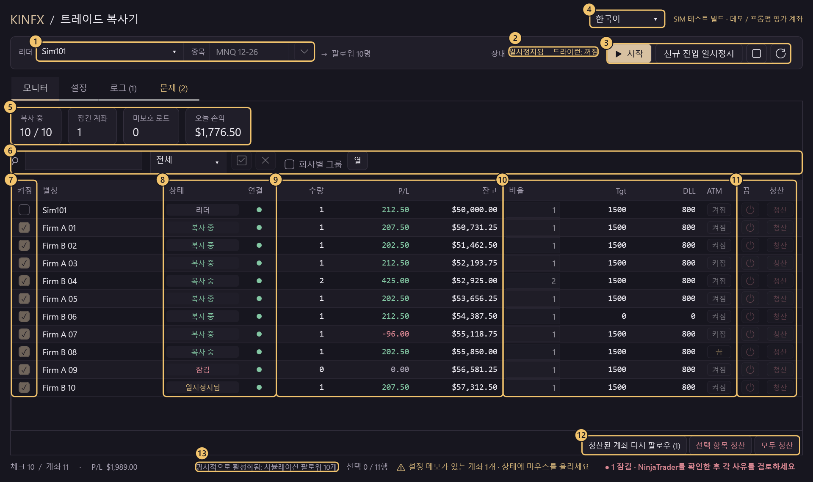
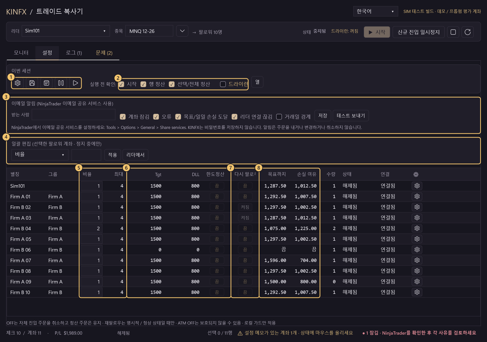
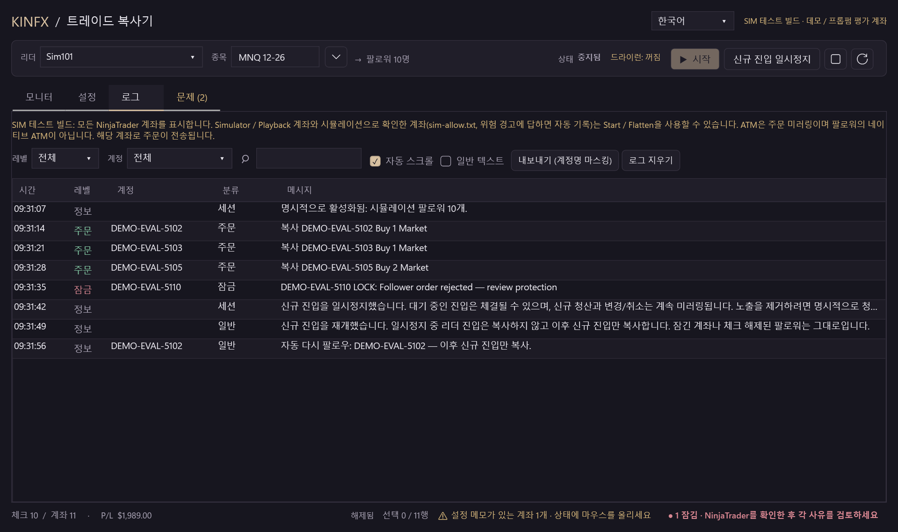
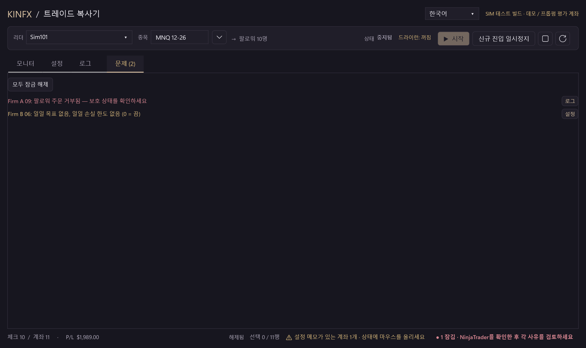

# KINFX Trade Copier

NinjaTrader 8에서 리더 계좌 하나의 거래를 여러 팔로워 계좌(Demo 계좌와 Prop Firm **시뮬레이션**／평가 계좌)로 복사합니다. 무료, 오픈 소스(MIT), 초기 **소스 alpha**입니다.

[中文](README.md) · [English](README.en.md) · [日本語](README.ja.md) · **한국어**

> ⚠️ **기본 빌드에서는 거래가 비활성화되어 있습니다. Funded／실계좌: 사용 금지.** 이것은 소스 alpha이며, **현재 소스는 수용되지 않았습니다.** 선택적으로 사용하는 SIM TEST 빌드는 Simulator／Playback 계좌와 사용자가 시뮬레이션으로 확인한 계좌로 주문을 보냅니다. 그 능력은 안전 수용이 아닙니다.

## 위험 및 면책

작성자와 기여자는 이 소프트웨어 사용으로 생기는 어떠한 결과나 손실에 대해서도 **책임을 지지 않습니다**. **Demo／Sim 전용으로만 권장**하며, 실거래 계좌나 실제 자금 계좌에는 **권장하지 않습니다**. 실험적인 커뮤니티 alpha이며, **투자 자문이 아닙니다**.

<!-- QUICKSTART:START -->
## 사용할 수 있습니까?

| 계좌 종류 | 상태 |
|---|---|
| **Demo／시뮬레이터 계좌** | 🟡 **테스트 중, 미수용.** 완료도는 약 **83%**입니다(가중된 과거 체크리스트이며, 릴리스 준비 비율이 아닙니다). |
| **Prop Firm 시뮬레이션／평가 계좌** | 🟡 **테스트 중, 미수용.** 완료도는 약 **75%**입니다(같은 과거 체크리스트). 실제 NinjaTrader 8.1.8.3에서 시뮬레이터 리더 1개와 운영자가 확인한 시뮬레이션 평가 계좌 최대 11개(Lucid, Tradeify)로 MNQ를 실행했습니다. 릴리스 수용도, 업체 규칙 인증도 아닙니다. |
| **Funded／실계좌** | ⛔ **금지.** |
<!-- QUICKSTART:END -->

## 화면 안내

창 하나에 탭이 4개 있습니다: **모니터**(복사 중에 보기), **설정**(중지 상태에서 변경), **로그**, **문제**.

### 모니터 탭(복사 중)



| # | 위치 | 기능 |
|:-:|---|---|
| 1 | **리더／종목** | 리더 계좌와 정확한 계약(예: `MNQ 12-26`)을 고릅니다. ▾는 주요 지수·금속·에너지 종목을 나열하며, 분기 만기 지수는 최근월을 채웁니다. |
| 2 | **상태／드라이런** | 중지됨, 복사 중, 일시정지됨 상태와 드라이런 켜짐／꺼짐을 항상 표시합니다. |
| 3 | **시작／신규 진입 일시정지／중지／새로고침** | **시작** 전에 모든 팔로워와 비율을 나열한 확인 창이 나옵니다. **신규 진입 일시정지**는 신규 진입만 멈추며, 청산과 주문 변경은 계속 미러링합니다. 일시정지 후에는 **신규 진입 재개**가 나타납니다. 일시정지 중 리더의 진입은 복사하지 않습니다. **중지**는 모든 계좌가 무포지션이고 미체결 주문이 없을 때만 됩니다. 그렇지 않으면 거부되고 일시정지 상태로 남으며, 나중에 자동으로 다시 시도하지 않고 신규 진입 재개도 할 수 없게 됩니다. |
| 4 | **언어** | English, 中文（繁體）, 日本語, 한국어. 중지 상태에서만 바꿀 수 있습니다. |
| 5 | **요약 카드** | 복사 중인 계좌 수, 잠긴 계좌(클릭하면 '문제' 탭 열기), 미보호 로트, 오늘 손익. |
| 6 | **도구 모음** | 검색(Ctrl+F), 상태 필터, 모두 선택／해제, 회사별 그룹, **열**(열 표시／숨기기, 저장됨). 계좌 이름 열은 기본적으로 숨겨지며, 자동 **별칭**(예: `FIRMAB..0001`)으로 계좌를 구분합니다. 마우스를 올리면 전체 이름을 보여 줍니다. |
| 7 | **켜짐** | 체크 = 팔로우, 체크 해제 = 신규 진입 중지. 리더 행은 항상 맨 위입니다. |
| 8 | **상태／연결** | 리더, 복사 중, 일시정지됨, 잠김, 청산됨 등. 마우스를 올리면 사유를 보여 줍니다. **잠김** 계좌는 먼저 NinjaTrader에서 확인하십시오. 자동 재시도는 없습니다. |
| 9 | **수량／P/L／잔고** | 포지션(＋매수／−매도), 이번 세션 손익, 통화 기호가 붙은 현금 잔고. **괴리** 열은 팔로워를 리더와 비교합니다: 수량이 비율대로인지(`qty±N`은 예상 포지션과의 부호 있는 차이), 평균가가 몇 틱 다른지(`adverse`는 불리한 방향). 표시 전용이며 주문을 내지 않습니다. |
| 10 | **비율／Tgt／DLL／ATM** | 계좌별 설정. 비율은 내림 처리되며, 최대를 넘는 주문은 통째로 건너뜁니다. Tgt／DLL = 일일 수익 목표／일일 손실 한도(0 = 끔). ATM = 청산 주문 미러링(익절／손절)이며, NinjaTrader 기본 ATM 전략의 복제가 아닙니다. |
| 11 | **끔／청산** | **끔** = 팔로우를 멈추고 자기 진입 주문을 취소합니다. 포지션과 청산 주문은 남습니다. **청산** = 확인 후 그 계좌 하나만 청산하며, 다른 계좌는 계속 복사합니다. |
| 12 | **청산된 계좌 다시 팔로우／선택 항목 청산／모두 청산** | 청산된 팔로워(리더 청산을 복사했거나 직접 청산)는 상태에 '청산됨'으로 표시되며 다음 진입을 받지 않습니다. 이 버튼으로 확인 후 다시 체크하며, 이후의 신규 진입만 복사합니다. 청산 버튼은 복사 중에도 쓸 수 있으며, 기본적으로 먼저 확인합니다. |
| 13 | **바닥글** | 세션 상태, 체크한 수, 합계 손익, 설정 메모, 잠긴 계좌 수. |

### 설정 탭(중지 상태에서 설정)



| # | 위치 | 기능 |
|:-:|---|---|
| 1 | **이번 세션** | 일괄 리스크／프리셋, 설정 저장, 거래일 경계와 시간대(경계 시각에 신규 진입을 일시정지할지, 알림만 할지), 선택한 계좌 일시정지／재개, 평균가 괴리 경고 기준(틱, 표시 전용). |
| 2 | **실행 전 확인／드라이런** | 시작, 행 청산, 선택／전체 청산의 확인 창. 체크를 해제하면 건너뜁니다('시작' 항목은 신규 진입 재개와 다시 팔로우에도 적용). 잠금 해제와 위험 경고는 항상 묻습니다. 드라이런은 `DRY RUN would send ...`를 기록할 뿐 아무것도 보내지 않습니다. |
| 3 | **이메일 알림** | 계좌 잠김, 오류, 목표／일일 손실 도달, 리더 연결 끊김, 거래일 경계 때 메일을 보냅니다. NinjaTrader 자체의 이메일 공유 서비스로 보내므로 KINFX는 비밀번호를 저장하지 않습니다. 계좌 이름은 가려지며 발송 수에 상한이 있습니다. 주소가 비어 있으면 꺼집니다. |
| 4 | **일괄 편집** | 항목(비율, 최대 계약 수, 일일 목표, 일일 손실, 한도 도달 시 청산, ATM 청산 주문 미러링, 다이버전스 시)을 고르고 값을 입력한 뒤 **적용**하면 선택한 팔로워에 반영됩니다. **리더에서**는 리더의 Tgt／DLL／ATM／한도청산／다이버전스 시를 한 번만 복사합니다(선택이 없으면 표시된 모든 팔로워). 중지 상태에서만. |
| 5 | **최대／비율** | 같은 종목의 최대 계약 수와 복사 배율. 최대는 계좌의 합계로 셉니다. 포지션＋미체결 진입＋새 주문이 최대를 넘으면 새 주문은 통째로 건너뜁니다. 1로 남은 최대는 테두리로 알려 줍니다. |
| 6 | **Tgt／DLL／한도청산** | 한도청산 = Tgt 또는 DLL에 도달하면 그 계좌를 한 번 청산합니다(재시도 없음). 끔(기본) = 잠그고 복사만 멈춥니다. |
| 7 | **다시 팔로우** | 켜짐 = 이 계좌의 복사된 청산이 끝나고 리더가 무포지션이 되면 자동으로 다시 체크하며, 이후의 신규 진입만 복사합니다. 직접 청산한 계좌는 자동으로 다시 체크하지 않습니다. 끔(기본) = 모니터 탭에서 직접 다시 팔로우. |
| 8 | **목표까지／손실 여유** | 일일 목표와 일일 손실 한도까지 남은 금액. |

### 로그 탭과 문제 탭



**로그**: 레벨(정보, 주문, 경고, 잠금, 오류)별로 색이 다르며, 레벨·계좌·문자로 거를 수 있습니다. **내보내기**는 계좌 이름을 가립니다. 날짜별 파일 `logs/kinfx-yyyyMMdd.log`도 씁니다.



**문제**: 모든 잠금 사유와 설정 메모를 나열하고, 각각 로그나 설정으로 가는 버튼이 있습니다. **모두 잠금 해제**는 중지 상태에서만 쓸 수 있으며, 한 번 확인한 뒤 무포지션이고 연결되어 있으며 리스크 한도에 더 이상 걸리지 않은 계좌만 해제하고, 복사를 시작하지 않습니다.

**스크린샷 출처:** 실제 대시보드 컨트롤을 **합성 DEMO** 모드로 그렸으며, **가상 계좌와 수치**입니다. 연결된 계좌, 엔진, 주문은 없습니다. 번호는 설명을 위해 붙였습니다. **NinjaTrader／provider 거래 증거가 아닙니다.** [화면 안내 렌더링 소스](docs/screenshots/Tour.cs) · [이전 갤러리 렌더링 소스](docs/screenshots/Screenshots.cs) · [다른 탭 이미지](docs/DEVELOPERS.md#dashboard-gallery-and-source)

## 설치 (Windows ＋ NinjaTrader 8)

**검토된 테스트용이며, 일반 공개가 아닙니다.** 컴파일되었다는 이유만으로 현재의 미수용 버전으로 거래하지 마십시오.

### NinjaTrader zip 가져오기(권장)

1. [v0.3.0-simtest-alpha](https://github.com/Kinfxhk/KINFXTradeCopier/releases/tag/v0.3.0-simtest-alpha)에서 `KINFXTradeCopier-SIMTEST.zip`을 내려받습니다(NinjaTrader 8이 직접 내보낸 파일. **압축을 풀지 마십시오**. SHA-256은 릴리스 노트에 있습니다). 이 페이지의 화면과 같은 내용입니다.
2. NinjaTrader: *Control Center > Tools > Import > NinjaScript Add-On...*에서 zip을 고릅니다.
3. 신뢰할 수 있는 출처인지 물으면 **Yes**. 파일이 이미 있다고 하면 **Yes**는 이 애드온의 이전 버전만 바꿉니다.
4. 요청하면 NinjaTrader를 다시 시작하고 *New > KINFX Trade Copier*를 엽니다.

> 이 zip은 실제 NinjaTrader에서 컴파일하고 대시보드를 열었지만, 신규 진입 재개, 다시 팔로우, 이메일 알림은 시작 후 아직 확인하지 않았습니다('제한' 참조).

<details>
<summary>소스로 설치</summary>

1. 이 페이지에서 *Code > Download ZIP*을 풀어 둡니다(또는 `git clone https://github.com/Kinfxhk/KINFXTradeCopier`).
2. 푼 폴더에서 PowerShell을 실행합니다:
   ```powershell
   powershell -ExecutionPolicy Bypass -File scripts\install-simtest.ps1
   ```
   SIM TEST 빌드를 `Documents\NinjaTrader 8\bin\Custom\AddOns`에 복사하고, 덮어쓰기 전에(zip으로 넣은 이전 버전 포함) `Documents\NinjaTrader 8\KINFX-backups`에 백업합니다. 계좌는 건드리지 않습니다. 다른 위치에 이 애드온이 하나 더 있으면 멈추고 그 경로를 알려 줍니다. 먼저 옮기십시오. `-WhatIf`는 미리보기, `-Remove`는 제거입니다.
3. NinjaTrader에서 *New > NinjaScript Editor*를 열고 **F5**를 누른 뒤 *Compile succeeded*를 기다립니다. 오류가 나면 중단합니다.
4. *New > KINFX Trade Copier*를 엽니다.

</details>

**계좌는 자동으로 불러옵니다.** 모든 NinjaTrader 계좌가 나열되며 체크할 수 있습니다. 계좌 이름을 입력하지 않습니다. Simulator／Playback이 아니고 아직 시뮬레이션으로 확인하지 않은 계좌(예: Prop Firm 평가 계좌)에서 **시작** 또는 **청산**을 처음 누르면, **그 계좌 이름을 적은 위험 경고**가 나옵니다. KINFX는 평가 계좌와 funded／실계좌를 구별할 수 없습니다. **예** = 시뮬레이션 계좌로 확인하며, `Documents\NinjaTrader 8\templates\KINFXTradeCopier\sim-allow.txt`에 저장되고 다시 묻지 않습니다. **아니오** = 저장하지도 보내지도 않습니다. 이 경고는 끌 수 없습니다. 다시 묻게 하려면 파일에서 해당 줄을 삭제하고 NinjaTrader를 다시 시작하십시오.

<details>
<summary>sim-allow.txt 직접 작성</summary>

**먼저 폴더를 만드십시오**: `Documents\NinjaTrader 8\templates\KINFXTradeCopier` (설치 프로그램은 **이 폴더를 만들지 않습니다**). 한 줄에 NinjaTrader Account `Name` 하나. 대소문자를 구분하며 완전히 일치해야 합니다. 로그인 이름이나 표시 별칭은 사용할 수 없습니다(`= 별칭`은 선택):

```text
# 운영자가 시뮬레이션으로 확인한 계좌만
MYFIRM-SIM-12345 = Firm A
MYFIRM-SIM-67890 = Firm B
```

잘못된 이름은 funded／실계좌로의 주문을 허용할 수 있습니다. 파일은 운영자의 진술이며 provider 검증이 아닙니다. 직접 수정한 파일은 **정적 초기화** 때 읽힙니다. 수정 후에는 중지 및 무포지션을 유지하고 copier 창을 닫은 다음 **NinjaTrader를 다시 시작**하십시오. **F5만 누르는 것**은 즉시 다시 읽기를 보장하지 않습니다. (위험 경고에서의 대답은 즉시 적용됩니다.)

</details>

## 처음 사용

1. *New > KINFX Trade Copier*. 이것은 SIM TEST 빌드의 리허설 목록이며, **현재의 미수용 소스로 거래해도 된다는 뜻이 아닙니다**.
2. **모니터** 탭에서 **리더**(예: `Sim101`)와 정확한 계약(예: `MNQ 12-26`, ▾에서도 고를 수 있음)을 고릅니다. NinjaTrader 기본 Orders／Positions 탭에서 리더와 선택한 모든 팔로워가 **연결됨**이고, 해당 종목의 **포지션은 0이고 미체결 주문은 없습니다**를 확인합니다. 시작할 때 기존 포지션을 인수하거나 누락분을 메우지 않습니다.
3. 팔로워는 **1개만** 체크합니다. **설정** 탭에서 그 계좌의 비율을 **1**, 최대를 **1**로 하고 **드라이런**을 켭니다. 상단에 '드라이런: 켜짐'이 표시됩니다.
4. **시작**을 누르고 리더, 팔로워, 계약, 비율, `DRY RUN` 확인을 읽습니다. 리더에서 작은 시뮬레이션 주문을 내면 **로그** 탭에 `DRY RUN would send ...`가 나옵니다. 드라이런이 막는 것은 copier의 전송뿐이며, **리더에 직접 넣는 주문은 막지 않습니다**. **신규 진입 일시정지** 후 **신규 진입 재개**도 시험해 볼 수 있습니다. 일시정지 중 리더의 진입은 복사하지 않습니다. 중지하기 전에 **NinjaTrader 기본 화면에서 Leader의 미체결 주문을 취소하고 Leader 포지션을 청산한 뒤**, 모든 계좌가 무포지션이고 미체결 주문이 없음을 확인합니다. 그다음 **Stop**(중지)을 누르고 세션이 분리되었는지 확인합니다. 거절되면 리허설을 멈추고 조사하며, 억지로 잠금을 풀지 마십시오.
5. **세션 연결이 해제된 뒤에만** 드라이런을 끌 수 있습니다. 그 뒤의 Start 확인에는 `DRY RUN`이 나오지 않으며 주문이 실제로 전송됩니다. **중지 상태에서만 팔로워를 추가**하고, 선택한 모든 계좌가 연결되어 있고 깨끗한지 다시 확인한 뒤, 전체 범위를 담은 새 **Start** 확인을 읽습니다.
6. 리더의 청산을 복사해 청산된 팔로워는 상태가 '청산됨'이 되며 다음 진입을 받지 않습니다. 모니터 탭의 **청산된 계좌 다시 팔로우**를 누르거나, 설정 탭에서 그 계좌의 **다시 팔로우**(자동. 직접 청산한 계좌는 제외)를 켭니다. 둘 다 이후의 신규 진입만 복사하며 누락분은 메우지 않습니다.

## 설정 파일 위치

모두 `Documents\NinjaTrader 8\templates\KINFXTradeCopier`에 있습니다. 애드온을 제거해도 이 파일은 지워지지 않습니다.

| 파일 | 내용 |
|---|---|
| `sim-allow.txt` | 시뮬레이션으로 확인한 계좌(위험 경고에서 '예'를 누르면 기록). |
| `<창 ID>.xml`, `last-workspace.xml` | 계좌별 비율, 최대, Tgt, DLL, ATM, 다시 팔로우 등과 거래일 경계. |
| `risk-latches.xml` | 잠금 기록. 다시 시작해도 남으며 '문제' 탭에서 해제합니다. |
| `columns.txt` | 열 표시 설정. 지우면 기본 열로 돌아갑니다. |
| `confirm-prefs.txt` | '실행 전 확인' 설정. |
| `notify.txt` | 이메일 알림 주소와 이벤트 종류(비밀번호 없음). |
| `language.txt`, `instruments-recent.txt` | 화면 언어, 최근 쓴 종목. |
| `display.json` | 평균가 괴리 경고 기준(틱). |
| `logs\kinfx-yyyyMMdd.log` | 날짜별 로그. `logs\export-*.txt`는 내보낸 로그(계좌 이름 가림)입니다. |

## 이메일 알림

1. NinjaTrader: *Tools > Options > General > Share services*에서 이메일 공유 서비스를 추가합니다. 메일 계정과 비밀번호는 NinjaTrader가 보관하며, KINFX는 읽거나 저장하지 않습니다.
2. KINFX **설정** 탭의 **이메일 알림**에서 주소를 입력하고, 알릴 이벤트를 체크한 뒤 **저장**을 누릅니다.
3. **테스트 보내기**를 누르고 받은편지함을 확인합니다. 오지 않으면 NinjaTrader의 *Log* 탭을 확인합니다.

주소가 비어 있으면 아무것도 보내지 않습니다. 주소를 넣으면 기본적으로 계좌 잠김, 오류, 목표／일일 손실 도달, 리더 연결 끊김을 알립니다. 거래일 경계는 기본적으로 꺼져 있습니다. 같은 계좌·같은 종류의 이벤트는 10분에 1통, 전체로는 1시간에 20통까지입니다. 나머지는 다음 메일에서 건수를 알려 줍니다. 메일 속 계좌 이름은 가려집니다. 알림이 주문을 내거나 바꾸거나 취소하는 일은 없습니다. **메일 발송은 실제 NinjaTrader에서 아직 확인하지 않았습니다.**

## 진행도

<!-- PROGRESS:START -->
### 진행도: Demo／Prop Firm 카피

```text
Demo         █████████████████████████░░░░░  83.0%
Prop firm    ██████████████████████░░░░░░░░  74.7%
```

✅ 실제 NinjaTrader에서 검증함 · 🟡 오프라인 테스트만 · ⬜ 아직 아님. 필수 항목 ✅: Demo 10/14 · Prop 10/15.

과거 체크리스트의 증거이며, 현재 후보를 수용한 것이 아닙니다. 현재 후보는 거래용으로 수용되지 않았습니다. 안전 P0／수용 관문: issue-3, issue-4, issue-7, issue-9. Demo ready=False; Prop ready=False. funded／실계좌 수용은 없습니다.

- ✅ 핵심 복사: 진입／청산／취소／정정
- ✅ 계좌별 비율＋최대 수량
- ✅ 무포지션 팔로워는 잠그지 않음
- ✅ 계좌별 청산 버튼
- ✅ 선택／전체 Flatten
- ✅ TP／SL 미러링＋OCO
- ✅ 위험 시 자동 잠금, 자동 재시도 없음
- ✅ 연결 끊김／재연결 안전
- 🟡 부분 체결 처리
- 🟡 수량 변경 전 체결 일치 (#2)
- 🟡 한 계좌의 정체가 다른 계좌를 멈추지 않음 (#4)
- ✅ 실제 NT에서 10–11 계좌（20–30은 아직）
- ✅ 대시보드（표, 일괄 편집, 잠금 사유） _（선택）_
- ✅ 계좌별 일일 목표／손실 한도
- ⬜ 괴리 시 한 번 Flatten (#12) _（선택）_
- ⬜ 기존 포지션 인수 (#11) _（선택）_
- ⬜ 계좌별 자체 TP/SL (#10) _（선택）_
- ⬜ 재시작 복구 (#6, 보류) _（선택）_
- ⬜ 설치 프로그램＋검토 후 릴리스
- ⬜ Prop Firm 규칙 확인（본 소프트웨어는 인증하지 않음）

지금까지의 실제 테스트: 시뮬레이터 리더 1개, 최대 11개의 **시뮬레이션** Prop Firm 평가 계좌(Lucid 5개, Tradeify 6개), MNQ, 시장가＋지정가＋역지정가, TP/SL OCO. funded 또는 실계좌는 사용한 적이 없습니다. 각 항목과 제한: [`docs/PROGRESS.json`](docs/PROGRESS.json). 배점은 가중치: ✅ 100%, 🟡 50%, 설계만 10%. 스냅샷 2026-10-15, 소스 `8a8deb196fa8`.
<!-- PROGRESS:END -->

체크와 백분율은 **가중된 과거 체크리스트**이며, **릴리스 준비 비율이 아닙니다**. 최근 실제 NinjaTrader 거래 테스트(2026-10-15 저녁)는 소스 `8a8deb196fa8`(SIM TEST 빌드, 이전 v0.2.0 zip과 같음)이며, 테스트 증거이지 수용이 아닙니다. 현재 소스의 화면은 2026-10-17에 실제 NinjaTrader에서 4개 언어 모두 페이지별로 확인했고, v0.3.0 zip의 파일도 실제 NinjaTrader에서 컴파일해 열었습니다(시작은 누르지 않았고 주문은 보내지 않았습니다). 신규 진입 재개, 다시 팔로우, 이메일 알림은 오프라인 테스트만 했습니다. [항목별 증거와 제한](docs/PROGRESS.json) · [실제 NT 테스트 기록](docs/VM-PROGRESS.md) · [오프라인 결과와 안전 차단](docs/DEVELOPERS.md)

## 제한

- **소스 alpha**이며, 수용된 거래 빌드가 아닙니다. **아직 증명되지 않았습니다:** 20–30 계좌, 실제 리더 연결 끊김(Simulator 리더는 다른 연결로 곧바로 다시 연결되므로 테스트 환경에서 재현할 수 없음), 실제 부분 체결, ATM 시작 실패, 정체된 provider 호출, 거부된 Flatten, 재시작 복구. 오프라인 컴파일／테스트는 이를 증명하지 않습니다.
- **2026-10-21 실제 NinjaTrader 8.1.8.4에서 확인** (SIM TEST 빌드, Sim101 리더, 모의 팔로워 2개, 주문당 MNQ 1계약): 일시정지 중 진입은 따라잡지 않음, 신규 진입 재개, 자동·수동 다시 팔로우, 괴리 열, 매도 진입과 환매, 지정가 취소, 계좌별 청산, 모두 잠금 해제, 포지션 없을 때 중지.
- **오프라인 테스트만:** 거래일 경계의 '알림만' 모드, 이메일 알림.
- 최대의 기본값은 1이며, 그 종목에서 계좌의 합계(포지션＋미체결 진입＋새 주문)로 셉니다. 넘으면 새 주문은 **통째로 건너뛰며**, 최대 수량으로 줄여서 보내지 않습니다. 추가 주문도 같습니다. 설정 탭은 1로 남은 최대를 테두리로 표시합니다.
- **잠김** 계좌는 NinjaTrader 기본 화면에서 조사하고 대조해야 합니다. 잠금 해제는 불확실한 엔진 기록, 숨은 수락된 요청, 예외를 던진 Flatten의 **대조가 아닙니다**. 검증된 무포지션 복구 관문은 아직 없습니다([#9](https://github.com/Kinfxhk/KINFXTradeCopier/issues/9), 알려진 FAIL `ExplicitManualFlatReconciliationAvailable`). copier는 Flatten을 재시도하지 않으며, 연결이 끊긴 뒤 누락분을 메우지 않습니다.
- 기준은 NinjaTrader 기본 Orders／Positions 탭이며, 이 창이 아닙니다. 직접 넣은 주문을 막을 수 없고, 체결을 보장하지 않습니다.
- 시험해 보려고 기본 빌드의 안전 보류를 제거하지 마십시오.

문제가 있으면 **가린** 로그(로그 탭의 **내보내기**로 계좌 이름이 가려집니다. 잔액은 빼 주십시오)를 첨부해 [issue](https://github.com/Kinfxhk/KINFXTradeCopier/issues)를 여십시오.

## 더 보기

[개발자 (English)](docs/DEVELOPERS.md) · [開發者（中文）](docs/DEVELOPERS.zh-HK.md) · [하지 말 것](docs/DO-NOT-DO.md) · [알려진 문제](docs/KNOWN-ISSUES.md) · [테스트 행렬](docs/TEST-MATRIX.md) · [로드맵](docs/ROADMAP.md) · [기여](CONTRIBUTING.md) · [보안](SECURITY.md)

개발자: 이식 가능한 검사(`python -B -m unittest discover -s tests -p 'test_*.py' -v`)는 패키징과 별도의 Python SPEC 연구를 다룹니다. SPEC은 C# 엔진 구현이 아닙니다. 이 검사는 copier, 증권사, 실제 주문을 실행하지 않습니다.

## 유지관리자 링크와 공개

유지관리자: KinFx. Prop Firm 규칙 조사, 비교표, 도구 링크, 추천 코드: **<https://linktr.ee/kinfx>**

그 페이지의 일부는 **제휴(affiliate)／추천 링크**입니다(예: 평가 코드와 파트너 가입). 사용하면 유지관리자가 수수료를 받을 수 있습니다. 이 링크는 **이 소프트웨어에 영향을 주지 않습니다**. 코드는 MIT이며, 추천이나 추적 로직이 없고, 여기서 업체나 구매를 권하지 않습니다. KinFx는 SEC／SFC 면허 자문가가 아니며, 내용은 투자 자문이 아닙니다. 평가 계좌의 대부분은 시뮬레이션입니다. 이 프로젝트는 그 페이지에 나온 업체와 제휴하지 않습니다.

## 라이선스

[MIT](LICENSE), © 2026 Kinfxhk. NinjaTrader, FlowBots／Replikanto, 어떤 증권사나 Prop Firm와도 제휴하지 않습니다. 경쟁 코드, 공급업체 DLL, 개인 계좌 로그, 자격 증명은 포함하지 않습니다. 소스의 Prop 템플릿은 과거의 편집 가능한 메타데이터이며, 현재 규칙이나 규정 준수 인증이 아닙니다.
