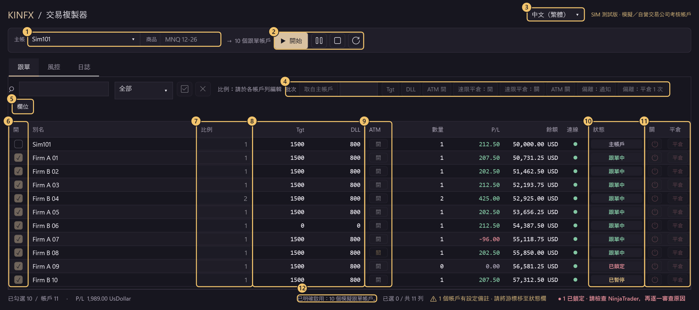
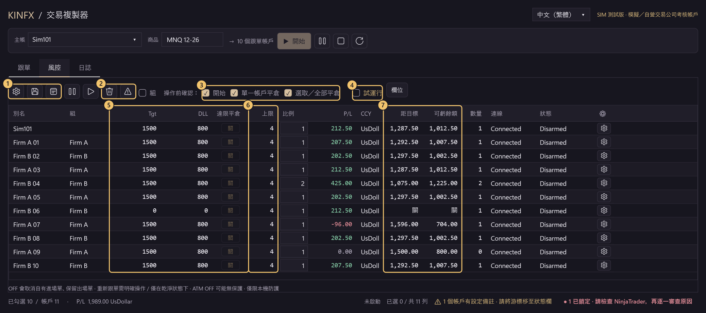

# KINFX Trade Copier

在 NinjaTrader 8 中，將一個主帳戶的交易同步複製至多個跟單帳戶（Demo 帳戶及 Prop Firm **模擬**／考核帳戶）。免費、開源（MIT），屬早期**源碼 alpha**。

**中文** · [English](README.en.md) · [日本語](README.ja.md) · [한국어](README.ko.md)

> ⚠️ **預設版已停用交易。Funded／實盤帳戶：禁止使用。** 本項目是源碼 alpha，**目前源碼尚未驗收**。主動選用的 SIM TEST 版會向 Simulator／Playback 及您確認為模擬的帳戶發送訂單，但此能力不是安全驗收。

<!-- QUICKSTART:START -->
## 可以用嗎？

| 帳戶類型 | 狀態 |
|---|---|
| **Demo／模擬帳戶** | 🟡 **測試中，尚未驗收。** 完成度約 **83%**（加權歷史檢查清單，並非發佈就緒百分比）。 |
| **Prop Firm 模擬／考核帳戶** | 🟡 **測試中，尚未驗收。** 完成度約 **75%**（同一歷史檢查清單）。已在真實 NinjaTrader 8.1.8.3 以 1 個模擬主帳戶及最多 11 個操作員確認的模擬考核帳戶（Lucid、Tradeify）測試 MNQ；此非發佈驗收，亦非公司規則認證。 |
| **Funded／實盤帳戶** | ⛔ **禁止使用。** |
<!-- QUICKSTART:END -->

## 介面導覽

### 跟單分頁（跟單進行中）



| # | 位置 | 用途 |
|:-:|---|---|
| 1 | **主帳／商品** | 選擇主帳戶及確切合約（例如 `MNQ 12-26`）。 |
| 2 | **開始／暫停／停止／重新整理** | **開始**前會顯示確認視窗，列出所有跟單帳戶及比例。暫停只暫停新進場；停止須在持倉歸零後進行；重新整理會重新讀取帳戶清單。 |
| 3 | **語言** | English、中文（繁體）、日本語、한국어，只可在停止時切換。 |
| 4 | **批次** | 為選取的帳戶一次設定 Tgt、DLL、ATM、達限平倉及偏離反應；**取自主帳戶**會把主帳戶的 Tgt／DLL／ATM 複製一次，之後可逐戶微調。只可在停止時使用，所以圖中呈灰色。 |
| 5 | **欄位** | 顯示或隱藏欄位（亦可在欄位標題按右鍵），設定會保存。帳戶名稱欄預設隱藏，以自動產生的**別名**辨認帳戶（例如 `FIRMAB..0001`），游標停留時顯示完整名稱。 |
| 6 | **開** | 勾選＝跟單；取消勾選＝停止新進場。 |
| 7 | **比例** | 每個帳戶獨立的倍數，結果向下取整。例如比例 2：主帳戶 1 手，此帳戶 2 手（仍受「上限」限制）。 |
| 8 | **Tgt／DLL** | 每日獲利目標／每日虧損上限（帳戶貨幣，0＝關閉）。觸及後鎖定該帳戶並停止跟單。 |
| 9 | **ATM** | 出場單跟隨（止盈／止損鏡像），並非複製 NinjaTrader 原生 ATM 策略。關閉時跟單帳戶可能沒有保護單。 |
| 10 | **狀態** | 主帳戶、跟單中、已暫停、已鎖定等；游標停留時顯示原因。**已鎖定**須先在 NinjaTrader 檢查，不會自動重試。 |
| 11 | **關／平倉** | **關**＝停止跟單並取消自有進場單，保留持倉及出場單。**平倉**＝確認後只平掉該帳戶，其他帳戶繼續跟單。 |
| 12 | **頁尾** | 工作階段狀態、勾選數量、合計 P/L、設定備註及鎖定帳戶數量。 |

### 風控分頁（停止時設定）



| # | 位置 | 用途 |
|:-:|---|---|
| 1 | **批次風控／儲存／交易日** | 預設組合、儲存設定、交易日分界及時區。 |
| 2 | **平倉選取／全部平倉** | 以市價平掉選取帳戶或所有顯示帳戶的持倉，預設會先確認。 |
| 3 | **操作前確認** | 開始、單一帳戶平倉、選取／全部平倉的確認視窗，取消勾選即可略過。解鎖及風險警告一定會詢問。 |
| 4 | **試運行** | 記錄 `DRY RUN would send ...`，但不發送任何指令。只可在停止時更改。 |
| 5 | **Tgt／DLL／達限平倉** | 達限平倉＝觸及 Tgt 或 DLL 時把該帳戶平倉一次（不重試）；關（預設）＝只鎖定並停止跟單。 |
| 6 | **上限** | 同一商品的最大合約數。 |
| 7 | **距目標／可虧餘額** | 距離每日目標及每日虧損上限尚餘的金額。 |

**截圖來源：**使用實際儀表板控制項，以**合成 DEMO** 模式呈現**虛構帳戶與數值**，未連接帳戶、引擎或訂單；編號標記為說明用途。截圖**並非 NinjaTrader／provider 交易證據**。[導覽呈現程式](docs/screenshots/Tour.cs) · [舊版圖庫呈現程式](docs/screenshots/Screenshots.cs) · [更多分頁截圖](docs/DEVELOPERS.zh-HK.md#dashboard-gallery-and-source)

## 安裝（Windows ＋ NinjaTrader 8）

**以下供已覆核的測試使用，不是一般發佈。** 不要僅因編譯成功便以目前未驗收的版本交易。

1. 從 [v0.2.1-simtest-alpha](https://github.com/Kinfxhk/KINFXTradeCopier/releases/tag/v0.2.1-simtest-alpha) 發佈頁下載 `KINFXTradeCopier-SIMTEST.zip`（由 NinjaTrader 8 本身匯出，**毋須解壓**；發佈說明列出 SHA-256）。
2. NinjaTrader：*Control Center > Tools > Import > NinjaScript Add-On...*，選取該 zip。
3. 詢問是否信任來源時按 **Yes**；若提示檔案已存在，按 **Yes** 只會取代本外掛的舊版本。
4. 按提示重新啟動 NinjaTrader，然後開啟 *New > KINFX Trade Copier*。

**帳戶自動載入。** 開啟後會列出所有 NinjaTrader 帳戶，可直接勾選，無須輸入帳戶名稱。首次對尚未確認為模擬的帳戶（Simulator／Playback 以外，例如 Prop Firm 考核帳戶）按**開始**或**平倉**時，會顯示**列明該帳戶的風險警告**：KINFX 無法分辨考核帳戶與已注資或實盤帳戶。按**是**＝您確認為模擬帳戶，帳戶會寫入 `Documents\NinjaTrader 8\templates\KINFXTradeCopier\sim-allow.txt`，以後不再詢問；按**否**＝不儲存、不發送任何指令。此警告不能關閉；如需再次詢問，請從檔案刪除該行。

<details>
<summary>從源碼安裝</summary>

1. 在本頁選擇 *Code > Download ZIP* 並解壓（或執行 `git clone https://github.com/Kinfxhk/KINFXTradeCopier`）。
2. 在解壓後的資料夾，以 PowerShell 執行：
   ```powershell
   powershell -ExecutionPolicy Bypass -File scripts\install-simtest.ps1
   ```
   腳本會將 SIM TEST 源碼複製至 `Documents\NinjaTrader 8\bin\Custom\AddOns`，取代舊檔前會備份，不會操作帳戶。`-WhatIf` 可預覽，`-Remove` 可移除。
3. 在 NinjaTrader 選擇 *New > NinjaScript Editor*，按 **F5**，等待 *Compile succeeded*。若出錯，請停止。

</details>

<details>
<summary>手動填寫 sim-allow.txt</summary>

請**先建立資料夾** `Documents\NinjaTrader 8\templates\KINFXTradeCopier`（安裝腳本**不會建立此資料夾**），每行填寫一個 NinjaTrader Account `Name`，區分大小寫、須完全相符，不能使用登入名稱或顯示別名（`= 別名` 為可選）：

```text
# 僅列出操作員已確認為模擬的帳戶
MYFIRM-SIM-12345 = Firm A
MYFIRM-SIM-67890 = Firm B
```

錯誤名稱可能授權向 funded／實盤帳戶發送訂單：這是操作員聲明，不是 provider 認證。手動修改的檔案只在**靜態初始化**時讀取：修改後請保持停止及已平倉，關閉 copier 視窗，再**重新啟動 NinjaTrader**。**僅按 F5** 並不保證即時重載。（在風險警告中的回答會即時生效。）

</details>

## 第一次使用

1. *New > KINFX Trade Copier*。以下是 SIM TEST 版的演練清單，**並非允許以目前未驗收的源碼交易**。
2. 選擇**主帳**（例如 `Sim101`）並輸入確切合約（例如 `MNQ 12-26`）。在 NinjaTrader 原生 Orders／Positions 分頁確認主帳戶及所有已選跟單帳戶**已連線**，該商品的**持倉為零且沒有掛單**。開始時不會承接現有倉位或補單。
3. 僅勾選 **1 個**跟單帳戶，比例設為 **1**。在**風控**分頁勾選**試運行**。
4. 按**開始**，核對主帳戶、跟單帳戶、合約、比例及 `DRY RUN` 確認內容。在主帳戶下一張小量模擬單，日誌應顯示 `DRY RUN would send ...`。試運行只阻止 copier 發送，**不會阻止您在主帳戶下單**。停止之前，**使用 NinjaTrader 原生工具取消 Leader 掛單並平掉 Leader 持倉**，確認所有帳戶均已平倉且沒有掛單，再按 **Stop**（停止）並確認工作階段已解除連接。如果拒絕停止，請中止演練並調查，不要強行解鎖。
5. **只有在工作階段已解除連接後**才可取消勾選試運行，之後的 Start 確認不再顯示 `DRY RUN`，訂單會真正發送。**僅在停止時新增 Follower**（跟單帳戶），再次核對所有已選帳戶已連線且狀態乾淨，並閱讀涵蓋完整範圍的新 **Start** 確認。

## 進度

<!-- PROGRESS:START -->
### 進度：Demo／Prop Firm 跟單完成度

```text
Demo         █████████████████████████░░░░░  83.0%
Prop firm    ██████████████████████░░░░░░░░  74.7%
```

✅ 已在真實 NinjaTrader 測試 · 🟡 只有離線測試 · ⬜ 尚未完成。必要項目 ✅：Demo 10/14 · Prop 10/15。

以下為歷史清單證據，不代表目前候選版本已通過驗收。目前候選版本尚未通過驗收，不可宣稱可用。安全 P0／驗收關卡：issue-3, issue-4, issue-7, issue-9。Demo ready=False；Prop ready=False。不包括 funded／實盤驗收。

- ✅ 核心跟單：入場／平倉／取消／改單
- ✅ 每戶 Ratio ＋ 最大手數
- ✅ Follower 無持倉時不會鎖定
- ✅ 每個帳戶獨立 Flat 按鈕
- ✅ 批量／全部 Flatten
- ✅ TP／SL 跟隨 ＋ OCO
- ✅ 異常自動鎖定帳戶，不會自動重試
- ✅ 斷線重連安全
- 🟡 部分成交處理
- 🟡 改量前成交一致 (#2)
- 🟡 單一帳戶停滯不影響其他帳戶 (#4)
- ✅ 真實 NT 的 10–30 個帳戶測試
- ✅ 介面（表格、批量改、鎖定原因） _（可選）_
- ✅ 每戶每日目標／虧損上限
- ⬜ 反向時平倉一次 (#12) _（可選）_
- ⬜ 承接現有倉位 (#11) _（可選）_
- ⬜ 每戶自管 TP/SL (#10) _（可選）_
- ⬜ 重啟恢復 (#6，擱置) _（可選）_
- ⬜ 安裝包 ＋ 覆核後發佈
- ⬜ Prop Firm 規則檢查（本軟件不作認證）

歷史真實測試：1 個模擬 Leader、最多 11 個**模擬** Prop Firm 評估帳戶（Lucid 5 個、Tradeify 6 個）、MNQ、市價＋限價＋停損單、TP/SL OCO。從未使用 funded 或實盤帳戶。各項詳情與限制：[`docs/PROGRESS.json`](docs/PROGRESS.json)。計分按權重：✅ 100%、🟡 50%、只有設計 10%。快照 2026-10-15，源碼 `8a8deb196fa8`。
<!-- PROGRESS:END -->

勾號及分數是**加權歷史檢查清單**，**並非發佈就緒百分比**。最近一次真實 NinjaTrader 測試（2026-10-15 晚上）使用源碼 `8a8deb196fa8`（SIM TEST 版，即發佈頁 zip 的版本），屬測試證據，不是驗收。[各項證據與限制](docs/PROGRESS.json) · [真實 NT 測試記錄](docs/VM-PROGRESS.md) · [離線結果與安全阻礙](docs/DEVELOPERS.zh-HK.md)

## 使用限制

- 本項目是**源碼 alpha**，不是已驗收的交易版本。**尚未證明：**20–30 個帳戶、真正的主帳戶斷線（Simulator 主帳戶會經另一連線即時重連，無法在測試環境重現）、真實部分成交、ATM 啟動失敗、provider 呼叫停滯、Flatten 被拒及重啟恢復。離線編譯／測試不能證明以上行為。
- **已鎖定**的帳戶須在原生 NinjaTrader 調查並核對。解鎖**不等於**核對不確定的引擎記錄、隱藏的已接受請求或拋出例外的 Flatten。仍缺少可驗證已平倉的恢復關卡（[#9](https://github.com/Kinfxhk/KINFXTradeCopier/issues/9)，已知 FAIL `ExplicitManualFlatReconciliationAvailable`）。copier 不會重試 Flatten，亦不會在斷線後補單。
- 以 NinjaTrader 原生 Orders／Positions 分頁為準，而非此視窗。本軟件不能阻止手動下單，亦不能保證成交。
- 不得為了試用而移除預設版的安全封鎖。

遇到問題？請開立 [issue](https://github.com/Kinfxhk/KINFXTradeCopier/issues) 並附上**已遮蓋敏感資料**的日誌（不含帳戶名稱、結餘）。

## 更多

[開發者與狀態詳情](docs/DEVELOPERS.zh-HK.md) · [請勿執行的操作](docs/DO-NOT-DO.md) · [已知問題](docs/KNOWN-ISSUES.md) · [測試矩陣](docs/TEST-MATRIX.md) · [路線圖](docs/ROADMAP.md) · [參與貢獻](CONTRIBUTING.md) · [安全](SECURITY.md)

開發者：可攜檢查（`python -B -m unittest discover -s tests -p 'test_*.py' -v`）涵蓋打包，以及另一套 Python SPEC 研究。SPEC 不是 C# 引擎實作；這些檢查不會運行跟單程式、券商或真實訂單。

## 維護者連結與披露

維護者：KinFx。Prop Firm 規則研究、比較表、工具連結及推薦碼：**<https://linktr.ee/kinfx>**

該頁部分是**聯盟（affiliate）／推薦連結**（例如考核優惠碼及夥伴註冊），使用後維護者可能獲得佣金。這些連結**不影響本軟件**：代碼採用 MIT 授權，不含推薦或追蹤邏輯，本頁亦不推薦任何公司或購買。KinFx 並非 SEC／SFC 持牌顧問，內容不構成投資意見。大部分考核帳戶為模擬帳戶。本項目與該頁列出的公司沒有關聯。

## 授權

[MIT](LICENSE)，© 2026 Kinfxhk。與 NinjaTrader、FlowBots／Replikanto、任何券商或 Prop Firm 沒有關聯。不包含競爭對手代碼、廠商 DLL、私人帳戶日誌或憑證。源碼內的 Prop 範本是歷史可編輯資料，不是現行規則或合規認證。
