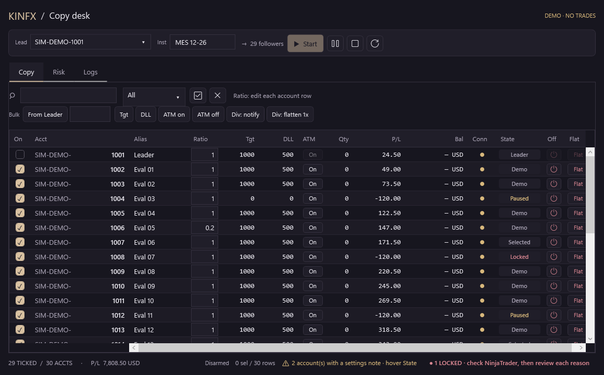
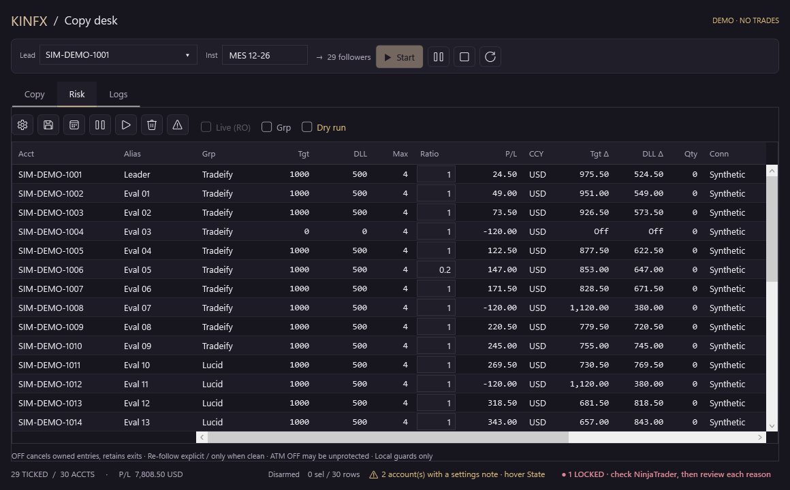
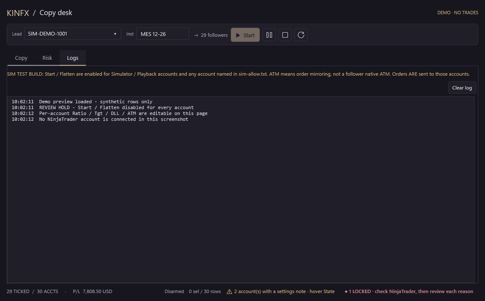

# KINFX Trade Copier — community development alpha

**TRADING DISABLED in the default build. Not a released trade copier. Do not use for live or funded prop accounts.**

A separate **SIM TEST build** (opt-in, built from the same source with `KINFX_SIM_TEST`) can copy between NinjaTrader **Simulator / Playback** accounts and between accounts you list in an operator allow-list that you attest are simulated. It has been run on a real NinjaTrader 8.1.8.3 with one Simulator leader and two prop-firm **simulated** evaluation accounts, 2 followers, 1 instrument, Market and Limit orders. That is the whole real-world evidence so far. See the progress bar below.

**English** · [廣東話／繁體中文](README.zh-HK.md)

<!-- QUICKSTART:START -->
## Can I use it? / 可以用嗎？

| | |
|---|---|
| **Demo / Simulator accounts** | **Yes, as an early test build.** Copying works in the SIM TEST build. Tested on real NinjaTrader 8.1.8.3 with 1 leader + 2 followers, 1 instrument, Market and Limit orders. About **62%** done, see the checklist below. |
| **Prop-firm accounts** | **Only your prop-firm *simulated / evaluation* accounts that you have checked yourself, and only for testing.** Tested on 2 such accounts. Not tested on funded accounts. About **56%** done. Check your firm's copier rules first: nothing here certifies compliance. |
| **Funded or live accounts** | **No.** Blocked in the default build. Do not add them to the allow-list. |

Read this before you start: it is an **alpha**. Disconnect/reconnect, TP/SL with Flat, 10-30 accounts and restart recovery are **not yet tested on real NinjaTrader**. Start with **1 lot, 1 follower, Dry run ON**, and keep NinjaTrader's own Orders / Positions tabs open: they are the truth, not this window. It cannot stop trades you place by hand and cannot guarantee fills.

## Install in 5 steps (Windows + NinjaTrader 8)

1. **Get the code.** `git clone https://github.com/Kinfxhk/KINFXTradeCopier` (or *Code > Download ZIP* and unzip). Use branch `release-candidate` for the latest: `git checkout release-candidate`.
2. **Install.** Close nothing, then in the repo folder run in PowerShell:
   ```powershell
   powershell -ExecutionPolicy Bypass -File scripts\install-simtest.ps1
   ```
   It copies the SIM TEST build to `Documents\NinjaTrader 8\bin\Custom\AddOns`, keeps a backup of anything it replaces, checks the file hash, and touches no account. Add `-WhatIf` to preview, `-Remove` to uninstall.
3. **Compile.** In NinjaTrader: *New > NinjaScript Editor*, press **F5**. Wait for *Compile succeeded*. (An error here means this add-on or another one in your Custom folder does not compile; do not continue.)
4. **Say which accounts are simulated.** Only *Simulator* and *Playback* accounts work by default. For prop-firm **simulated** accounts, create a text file `Documents\NinjaTrader 8\templates\KINFXTradeCopier\sim-allow.txt`, one account per line, exact name as shown in NinjaTrader, optional alias after `=`:
   ```text
   # only accounts YOU have confirmed are simulated
   MYFIRM-SIM-12345 = Firm A
   MYFIRM-SIM-67890 = Firm B
   ```
   Wrong entry = real orders to that account. Then press F5 again.
5. **Open it and try a dry run.** *New > KINFX Trade Copier*. Pick the **Leader** (e.g. `Sim101`), type the instrument (e.g. `MNQ 12-26`), tick **one** follower, set Ratio **1**. On the **Risk** tab tick **Dry run**. Press **Start**: the confirmation must say `DRY RUN`. Place one small order on the leader and check the Logs tab shows `DRY RUN would send ...`. Press **Stop**. Only then untick Dry run and repeat with 1 lot.

**Things to know:** after a leader exit the follower row goes to `Off` and must be ticked again (deliberate). **OFF** only stops following; **Flat** (every row) closes that one account after a confirmation. A **Locked** row means the copier saw something it could not explain: look in NinjaTrader, fix it by hand, then unlock from the row's gear button. It never retries a Flatten and never catches up after a disconnect.

Trouble? Open an issue with a **redacted** Logs tab (no account names, no balances). Details of what was and was not tested: [docs/VM-PROGRESS.md](docs/VM-PROGRESS.md).
<!-- QUICKSTART:END -->

Original MIT-licensed NinjaTrader 8 AddOn by Kinfxhk, published early so people can review, reproduce failures and improve it together. We are not waiting for every feature before sharing the source. This repository is a development baseline, not an accepted integration of all researched fixes.

## Status: what is done, what is not / 進度：已完成與未完成

Two kinds of evidence are kept apart. **Offline** numbers use fake accounts and prove logic only. **Real NinjaTrader** results come from a VM running NinjaTrader 8.1.8.3 with the SIM TEST build, and are listed with their limits in [VM-PROGRESS](docs/VM-PROGRESS.md). Neither is prop-firm or live acceptance. 離線數字用假帳戶，只證明邏輯；真 NinjaTrader 結果來自跑 NinjaTrader 8.1.8.3 嘅 VM（SIM TEST 版），限制見 [VM-PROGRESS](docs/VM-PROGRESS.md)。兩者都唔等於 Prop Firm 或實盤驗收。

<!-- PROGRESS:START -->
### Achievements: Demo / Prop-firm copying

```text
Demo         ███████████████████░░░░░░░░░░░  61.7%
Prop firm    █████████████████░░░░░░░░░░░░░  55.6%
```

✅ tested on real NinjaTrader · 🟡 offline tests only · ⬜ not yet. Must-haves ✅: Demo 4/14 · Prop 4/15.

- ✅ Core copy: entry / exit / cancel / modify
- ✅ Per-account Ratio + max-lot cap
- ✅ No lock-up on a flat follower
- ✅ Flat button on every account
- 🟡 Flatten selected / all
- 🟡 TP / SL mirroring + OCO
- 🟡 Auto-lock on danger, no auto-retry
- 🟡 Disconnect / reconnect safe
- 🟡 Partial fills handled
- 🟡 Fill frontier before resize (#2)
- 🟡 One stuck account never freezes others (#4)
- ⬜ 10-30 accounts on real NT
- ✅ Dashboard (table, bulk edit, lock reasons) _(optional)_
- 🟡 Daily target / loss limit per account
- ⬜ Flatten once on divergence (#12) _(optional)_
- ⬜ Adopt existing position (#11) _(optional)_
- ⬜ Self-managed TP/SL (#10) _(optional)_
- ⬜ Restart recovery (#6, shelved) _(optional)_
- ⬜ Installer + reviewed release
- ⬜ Prop-firm rule check (never certified)

Real tests so far: 1 simulator leader, 2 **simulated** prop-firm evaluation accounts, MNQ, Market + Limit. No funded or live account was ever used. Each tick and its limits: [`docs/PROGRESS.json`](docs/PROGRESS.json). Score = weighted: ✅ 100%, 🟡 50%, design only 10%. Snapshot 2026-10-13, source `28bc4bb3bc47`.
<!-- PROGRESS:END -->

### Done (in this repository) / 已完成（已在本 repo）

| English | 中文 |
|---|---|
| Three-tab dashboard (Copy / Risk / Logs) built for 10–30 accounts; per-account Ratio, Tgt (daily target), DLL (daily loss), ATM exit-mirroring and OFF in each row | 三個分頁（Copy／Risk／Logs），為 10–30 個帳戶設計；每行都有獨立 Ratio、Tgt（每日目標）、DLL（每日虧損）、ATM 出場跟隨、OFF |
| Bulk edit of Tgt / DLL / ATM for highlighted accounts, and **From Leader** as a one-time default you can fine-tune per row | 批量改 Tgt／DLL／ATM（只改選中嘅帳戶），**From Leader** 一鍵以 Leader 做預設，之後可逐戶手動微調 |
| Per-account **On divergence** setting (`Notify` default, `FlattenOnce` optional). **Stored only**: the engine never flattens by itself | 每戶「反向時反應」設定（預設只通知，可選平倉一次）。**只係儲存**，引擎唔會自動平倉 |
| Settings warnings, locked-account count, draft protection for numeric fields | 設定警告、鎖定帳戶計數、數值欄位草稿保護 |
| Safety policy decided for exits after ambiguous flat telemetry and after a thrown Flatten: lock, keep protection, never retry ([#9](https://github.com/Kinfxhk/KINFXTradeCopier/issues/9)) | 已定政策：持倉但讀到 flat、或 Flatten 拋例外後，鎖帳戶、保留保護單、唔重試（[#9](https://github.com/Kinfxhk/KINFXTradeCopier/issues/9)） |
| Mailbox fix: a callback or poll refused by a stopped worker can no longer leave counters stuck ([#4](https://github.com/Kinfxhk/KINFXTradeCopier/issues/4), partial; independently reviewed) | Mailbox 修正：worker 停止後被拒絕嘅回報／輪詢唔再令計數卡死（[#4](https://github.com/Kinfxhk/KINFXTradeCopier/issues/4)，部分；已獨立覆核） |
| **Per-account Flat button** on every follower row: asks for confirmation naming the account and instrument, flattens only that account, the others keep copying; confirmed flat only from provider evidence, never retried, locks if unconfirmed after 20 s. Tested offline and on real NinjaTrader | **每戶獨立 Flat 按鈕**：每個 follower 行一個，確認框列明帳戶同合約，只平該戶，其他戶繼續跟；要 provider 證據先確認已平，唔重試，20 秒未確認就鎖。離線同真 NinjaTrader 都測過 |
| **Exit lock-up fixed**: after two completed round trips a leader exit with nothing to close locked flat followers after 10 s. Reproduced offline, fixed, replayed on real NinjaTrader | **修正鎖死問題**：兩次來回交易後，leader 平倉但 follower 冇倉，10 秒後鎖死。離線重現、修正，並喺真 NinjaTrader 重放 |
| Disconnect / reconnect and partial-fill cases (8 offline cases, each with a mutant): no catch-up, protection kept, shortfall never made up | 斷線重連同部分成交測試（8 個離線測試，每個都有 mutant）：唔補單、保護單保留、唔補差額 |
| Default build keeps the trading hold on every provider; reproducible test runner, CI, 12 tracked issues, screenshots, bilingual safety notes | 預設版所有 provider 交易封鎖；可重現測試工具、CI、12 個 Issue、截圖、中英安全說明 |

Latest offline results / 最新離線結果 (source `28bc4bb3bc47`, also reproduced on the VM): C# engine **207 PASS / 0 FAIL**, pure 32/32, independent review suite 24 PASS / 1 known FAIL ([#6](https://github.com/Kinfxhk/KINFXTradeCopier/issues/6)), dashboard UI **45/45**, Python 457 OK, full AddOn compile-only OK. Counts are invocations, not a completion percentage; the bar above is the completion estimate. Details and caveats: [TEST-MATRIX](docs/TEST-MATRIX.md).

### Not done / 未完成

| English | 中文 |
|---|---|
| **Real NinjaTrader testing is thin**: one leader, two followers, one instrument (MNQ), Market and Limit only. Not yet tested for real: disconnect/reconnect, partial fills, Flat with a TP/SL, a rejected Flatten, slippage, workspace close and restart, multi-monitor DPI, 10–30 accounts | **完全未用真 NinjaTrader 帳戶測試**（連 Sim／Playback 都未）：兩個 Demo 帳戶 Leader→Follower、真實 provider 回報、斷線重連、滑點、關閉 workspace 及重啟、真實多螢幕 DPI、30 戶實際延遲 |
| **The default build still has Start and Flatten disabled**; copying works only in the opt-in SIM TEST build, and only for Simulator / Playback accounts or names in your allow-list. There is no installer or signed release | **Start 同 Flatten 全部封鎖**，所以冇任何跟單，亦冇一鍵全平 |
| Coherent fill frontier before protective resize ([#2](https://github.com/Kinfxhk/KINFXTradeCopier/issues/2)) | 保護單改量前，成交資料一致性（[#2](https://github.com/Kinfxhk/KINFXTradeCopier/issues/2)） |
| Group OCO: a still-open group's protection is no longer cancelled when another group completes ([#3](https://github.com/Kinfxhk/KINFXTradeCopier/issues/3), narrow fix **merged**). **Still open:** if a group completes before the entry is fully filled, the account locks and the other group's waiting exit is never sent (lots unprotected until you act; the lock text now says exactly how many lots are UNPROTECTED and tells you to act in NinjaTrader, and the copier never creates the order itself); fractional allocation | 多組 OCO：一組完成唔再取消另一組仍開放嘅保護（[#3](https://github.com/Kinfxhk/KINFXTradeCopier/issues/3)，窄範圍修正**已合併**）。**仍未完成：**入場未全部成交時一組完成，帳戶會鎖定，另一組等待中嘅出場單唔會送出（倉位冇保護，要人手處理）；出場分配 |
| One stalled follower no longer freezes the others: each account has its own provider-call thread ([#4](https://github.com/Kinfxhk/KINFXTradeCopier/issues/4), merged, offline fake only). **Still open:** real NinjaTrader thread rules for these calls are unverified; Dispose waits at most 3 s | 一個卡住嘅 follower 唔再凍結其他戶：每戶有自己嘅 provider 呼叫線程（[#4](https://github.com/Kinfxhk/KINFXTradeCopier/issues/4)，已合併，只喺離線假環境驗證）。**仍未完成：**真 NinjaTrader 對呢啲呼叫嘅線程規則未驗證；Dispose 最多等 3 秒 |
| Typed Ratio / Max / Target / DLL text is kept, flagged and blocks commit instead of being silently replaced ([#5](https://github.com/Kinfxhk/KINFXTradeCopier/issues/5), partly merged). **Still open:** Risk-dialog fields are only checked on Apply; high-precision XML round-trip; real window focus / IME / paste | Ratio／Max／Target／DLL 打錯嘅字會保留、標示並阻止提交，唔會被悄悄換走（[#5](https://github.com/Kinfxhk/KINFXTradeCopier/issues/5)，部分已合併）。**仍未完成：**Risk 對話框其他欄位只喺按 Apply 時檢查；高精度 XML 往返；真實視窗焦點／輸入法／貼上 |
| Journal and verified restart recovery ([#6](https://github.com/Kinfxhk/KINFXTradeCopier/issues/6)): **shelved by the maintainer**, not worked on now | Journal 及重啟後可驗證恢復（[#6](https://github.com/Kinfxhk/KINFXTradeCopier/issues/6)）：**維護者暫時擱置** |
| Per-account self-managed TP/SL that does not follow the leader's exit ([#10](https://github.com/Kinfxhk/KINFXTradeCopier/issues/10)): not started | 每戶自管 TP／SL、唔跟 Leader 平倉（[#10](https://github.com/Kinfxhk/KINFXTradeCopier/issues/10)）：未開始 |
| Adopt an existing position on a just-connected follower ([#11](https://github.com/Kinfxhk/KINFXTradeCopier/issues/11)): not built | 新連接帳戶承接現有倉位再跟方向（[#11](https://github.com/Kinfxhk/KINFXTradeCopier/issues/11)）：未做 |
| The actual reaction to divergence, e.g. one-time flatten ([#12](https://github.com/Kinfxhk/KINFXTradeCopier/issues/12)): only the setting exists | 反向時真正嘅反應（例如平倉一次）（[#12](https://github.com/Kinfxhk/KINFXTradeCopier/issues/12)）：只有設定，冇行為 |
| Native follower ATM cloning, installer, compiled release, prop-firm compliance checks | 原生 follower ATM 複製、安裝包、編譯版本、prop firm 合規檢查 |

### What you can safely do now / 而家可以安全做嘅事

Read the code, run the offline tests, review or reproduce failures, and send small focused PRs. If you test the SIM TEST build, use only accounts that really are simulated, one leader and at least one follower, read the Start confirmation (it must not say DRY RUN unless you chose it), and keep NinjaTrader's own Orders / Positions tabs open as the source of truth. Do **not** point it at a funded or live account. 睇代碼、跑離線測試、覆核或重現失敗、提交細而專注嘅 PR。**唔好**為咗試下而強行解除交易封鎖。

## What is here

- One native dusk-dark Copy / Risk / Logs dashboard, designed for 10–30 accounts.
- Independent per-account Ratio, target, daily loss and ATM exit-mirroring intent.
- Original engine and Framework-only synthetic test fixtures, with known failures disclosed.
- Separate pure Python NR01/NR02/NR03 **SPEC research**, not a C# engine implementation.
- Test matrix, priority backlog and contribution templates.

The intended later flow is Leader → tick followers → set each Ratio → Start. **Start and Flatten remain held for every real NT8 account.** OFF is not Flatten. ATM means exit-order mirroring, not native follower ATM cloning. Cash is CashValue with its denomination, not equity. No global Ratio setting.

## What it looks like

Rendered from the real `DashboardView` in synthetic DEMO mode: no NinjaTrader account, no engine, no orders. Demo rows never reach the engine, so every button here is inert in the picture. The default build keeps Start/Flatten held. Names are fake. Source: [`docs/screenshots/Screenshots.cs`](docs/screenshots/Screenshots.cs). Balances/P&L are made-up demo values; unknown cash is shown as an unavailable dash. These are 1160x720 offscreen renders, not a real NinjaTrader window, so fonts/DPI can differ. An automated visual read suggested the Ratio column may be tight at this width; see [#8](https://github.com/Kinfxhk/KINFXTradeCopier/issues/8).

Copy tab: per-account Ratio / Tgt / DLL / ATM / OFF / **Flat** are in each row (Flat closes that one account after a confirmation; OFF only stops following), and the **Bulk** bar sets Tgt, DLL or ATM on all highlighted followers at once, and **From Leader** copies the leader row's Tgt / DLL / ATM to them as a one-time default you can then fine-tune per row (Ratio and ticks are never touched). Rows with legal-but-risky settings (no daily limit, a Ratio that gives 0 lots, size capped by Max) get a settings note on the State cell and a count in the footer; it only informs, it never blocks. Self-managed per-account TP/SL is not implemented yet: [#10](https://github.com/Kinfxhk/KINFXTradeCopier/issues/10).

| Copy | Risk | Logs |
|---|---|---|
|  |  |  |

## Start contributing safely

Python 3.10+; no Python packages, trading account or NT8 needed:

```sh
python -B -m unittest discover -s tests -p 'test_*.py' -v
```

These portable checks test packaging/holds and a separate SPEC; they do **not** run the C# copier, a broker or real orders. For Windows Framework-only engine tests and full **compile-only** NT8 checks, see [build instructions](docs/BUILD.md). No vendor assemblies are redistributed. No installer or compiled trading binaries are provided.

## Read before testing

- [Test matrix: untested vs failed vs scoped evidence](docs/TEST-MATRIX.md)
- [**Offline status: done vs needs a real environment**](docs/OFFLINE-STATUS.md)
- [Two-account Sim test **plan** (PLAN ONLY, do not run; trading stays blocked)](docs/SIM-TEST-PLAN.md)
- [Known issues](docs/KNOWN-ISSUES.md)
- [**Do NOT do these things** (actions the software cannot recover from)](docs/DO-NOT-DO.md)
- [Safety hold](docs/SAFETY-HOLD.md)
- [Community roadmap](docs/ROADMAP.md)
- [Contribution workflow](CONTRIBUTING.md)
- [Testing and redacted bug reports](docs/COMMUNITY-TESTING.md)

Use [Discussions](https://github.com/Kinfxhk/KINFXTradeCopier/discussions) for architecture questions and test-plan proposals; use Issues for reproducible failures and scoped work. Please open an issue with a minimal synthetic trace or failing test, then a focused PR. Start with the [community backlog](https://github.com/Kinfxhk/KINFXTradeCopier/issues):

| Workstream | Issue |
|---|---|
| Clean-clone build / safe test runner | [#1](https://github.com/Kinfxhk/KINFXTradeCopier/issues/1) |
| Fill frontier / protective resize | [#2](https://github.com/Kinfxhk/KINFXTradeCopier/issues/2) |
| Group OCO / fractional allocation | [#3](https://github.com/Kinfxhk/KINFXTradeCopier/issues/3) |
| Mailbox / Dispose / follower isolation | [#4](https://github.com/Kinfxhk/KINFXTradeCopier/issues/4) |
| Numeric drafts / settings publication | [#5](https://github.com/Kinfxhk/KINFXTradeCopier/issues/5) |
| Journal / restart recovery | [#6](https://github.com/Kinfxhk/KINFXTradeCopier/issues/6) |
| Future two-account simulator test plan | [#7](https://github.com/Kinfxhk/KINFXTradeCopier/issues/7) |
| Native UI / accessibility / DPI | [#8](https://github.com/Kinfxhk/KINFXTradeCopier/issues/8) |

**Do not remove the hold just to get a simulation run or a green test.** Simulator acceptance needs a separately reviewed opt-in design and at least a leader plus follower test account; it is not authorized by this alpha.

## Current evidence boundary

Past offline runs tested multiple immutable candidates. Passing those candidates does not mean their fixes are merged here. The published source is based on the previously held original baseline plus publication safety hardening only. Counts are per suite/artifact, not a completion percentage. [Evidence summary](docs/EVIDENCE.json) separates C# engine evidence, UI probes, harness incidents and Python SPEC results.

No full provider acceptance, restart recovery, broker OCO atomicity, native follower ATM, live-copy safety or prop-firm compliance is established. This software cannot intercept every manual/strategy order or guarantee fills. Existing positions must be managed with native NT8/broker tools, not this held preview.

## Maintainer links and disclosure

Maintainer: KinFx. Prop-firm rule research, comparison tables, tool links and referral codes: **<https://linktr.ee/kinfx>**

Some links on that page are **affiliate / referral links** (for example prop-firm evaluation codes and partner sign-ups); the maintainer may earn a commission if you use them. They have **no influence on this software**: the code is MIT, contains no referral logic or tracking, and nothing here recommends a firm or a purchase. KinFx is not an SEC/SFC-licensed adviser; content is not investment advice. Most evaluation accounts are simulated. This project is not affiliated with any firm listed there.

## License and attribution

[MIT](LICENSE), © 2026 Kinfxhk. Not affiliated with NinjaTrader, FlowBots/Replikanto, any broker or prop firm. No competitor code, vendor DLLs, downloaded research HTML, private account logs or credentials are included. Prop templates embedded in the source are historical editable metadata, not current rules or compliance certification.

## 廣東話／繁體中文

完整中文版（進度、已完成、未完成、截圖、參與方式、披露）：**[README.zh-HK.md](README.zh-HK.md)**

呢個係**公開共同開發 alpha，唔係可跟單正式版**。真 NT8 帳戶（包括 Sim／Playback）交易仍然封鎖。
