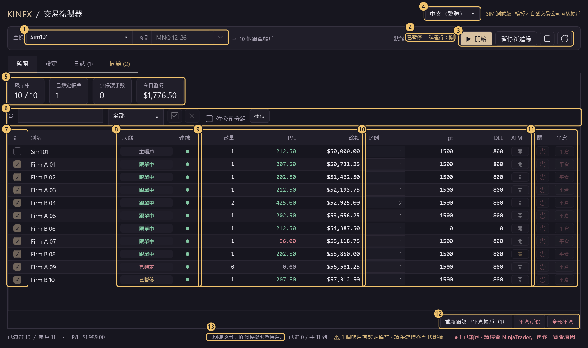
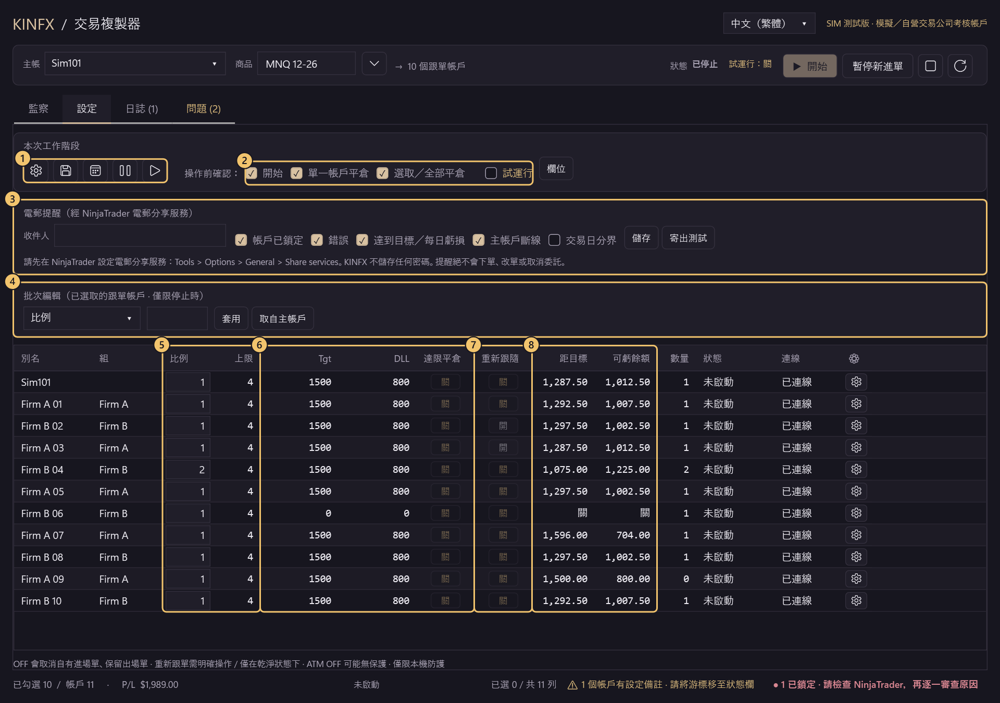
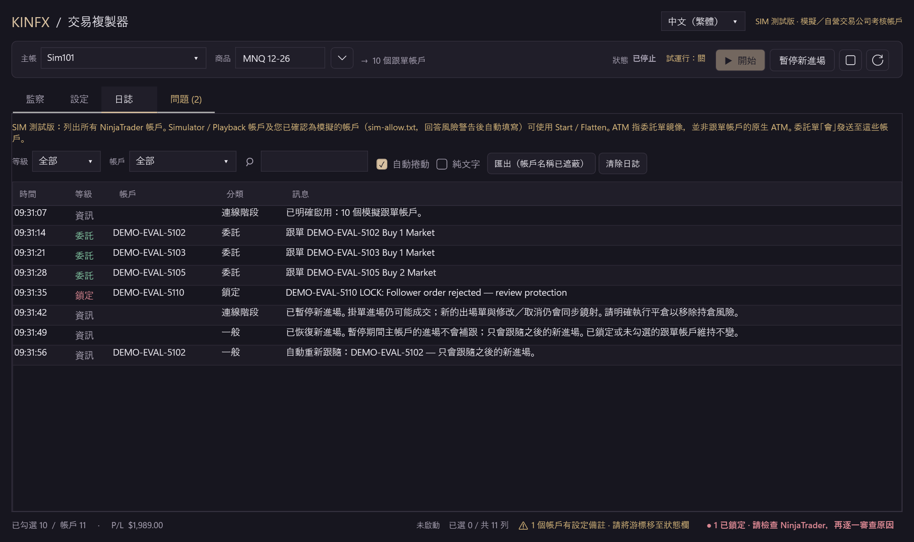
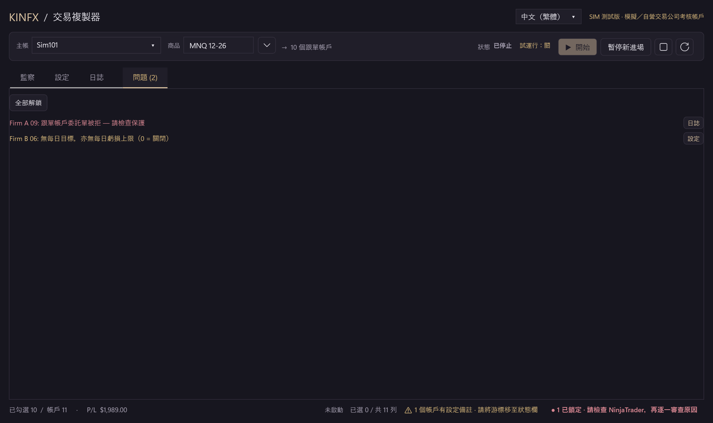

# KINFX Trade Copier

在 NinjaTrader 8 中，將一個主帳戶的交易同步複製至多個跟單帳戶（Demo 帳戶及 Prop Firm **模擬**／考核帳戶）。免費、開源（MIT），屬早期**源碼 alpha**。

**中文** · [English](README.en.md) · [日本語](README.ja.md) · [한국어](README.ko.md)

> ⚠️ **預設版已停用交易。Funded／實盤帳戶：禁止使用。** 本項目是源碼 alpha，**目前源碼尚未驗收**。主動選用的 SIM TEST 版會向 Simulator／Playback 及您確認為模擬的帳戶發送訂單，但此能力不是安全驗收。

## 風險與免責聲明

作者及貢獻者對使用本軟件所造成的任何後果或損失**概不負責**。本軟件**只建議用於 Demo／模擬（Sim）**，**不建議**用於實盤或真實資金帳戶。此為實驗性質的社群 alpha，**並非投資意見**。

<!-- QUICKSTART:START -->
## 可以用嗎？

| 帳戶類型 | 狀態 |
|---|---|
| **Demo／模擬帳戶** | 🟡 **測試中，尚未驗收。** 完成度約 **83%**（加權歷史檢查清單，並非發佈就緒百分比）。 |
| **Prop Firm 模擬／考核帳戶** | 🟡 **測試中，尚未驗收。** 完成度約 **75%**（同一歷史檢查清單）。已在真實 NinjaTrader 8.1.8.3 以 1 個模擬主帳戶及最多 11 個操作員確認的模擬考核帳戶（Lucid、Tradeify）測試 MNQ；此非發佈驗收，亦非公司規則認證。 |
| **Funded／實盤帳戶** | ⛔ **禁止使用。** |
<!-- QUICKSTART:END -->

## 介面導覽

一個視窗分四頁：**監察**（跟單時看這頁）、**設定**（停止時調整）、**日誌**、**問題**。

### 監察分頁（跟單進行中）



| # | 位置 | 用途 |
|:-:|---|---|
| 1 | **主帳／商品** | 選擇主帳戶及確切合約（例如 `MNQ 12-26`）。▾ 會列出常用指數、金屬及能源合約，季度指數合約會自動填入近月。 |
| 2 | **狀態／試運行** | 常駐顯示：已停止、跟單中、已暫停；以及試運行開或關。 |
| 3 | **開始／暫停新進場／停止／重新整理** | **開始**前會顯示確認視窗，列出所有跟單帳戶及比例。**暫停新進場**只暫停新進場，出場及改單照常跟隨；暫停後會出現**恢復新進場**，暫停期間主帳戶的進場不會補跟。**停止**須在所有帳戶持倉歸零且沒有掛單時按下；否則會拒絕停止並保持暫停，不會稍後自動再試，亦不能再按恢復新進場。 |
| 4 | **語言** | English、中文（繁體）、日本語、한국어，只可在停止時切換。 |
| 5 | **總覽卡** | 跟單中帳戶數、已鎖定帳戶（按一下開啟「問題」分頁）、無保護手數、今日盈虧。 |
| 6 | **工具列** | 搜尋（Ctrl+F）、狀態篩選、全部勾選／取消、依公司分組、**欄位**（顯示或隱藏欄位，設定會保存）。帳戶名稱欄預設隱藏，以自動產生的**別名**辨認帳戶（例如 `FIRMAB..0001`），游標停留時顯示完整名稱。 |
| 7 | **開** | 勾選＝跟單；取消勾選＝停止新進場。主帳戶永遠排第一列。 |
| 8 | **狀態／連線** | 主帳戶、跟單中、已暫停、已鎖定、已平倉等；游標停留時顯示原因。**已鎖定**須先在 NinjaTrader 檢查，不會自動重試。 |
| 9 | **數量／P/L／餘額** | 持倉（＋多／−空）、本工作階段盈虧、現金餘額（附貨幣符號）。**偏差**欄比較跟單帳戶與主帳戶的持倉：數量是否符合比例（`qty±N` 是與預期持倉的帶正負號差額），以及均價差多少 ticks（`adverse` 表示對你不利）。只作顯示，不會下單。 |
| 10 | **比例／Tgt／DLL／ATM** | 每個帳戶獨立設定。比例向下取整；換算後超過「上限」的單會整筆略過；Tgt／DLL＝每日獲利目標／每日虧損上限（0＝關閉）；ATM＝出場單跟隨（止盈／止損鏡像），並非複製 NinjaTrader 原生 ATM 策略。 |
| 11 | **關／平倉** | **關**＝停止跟單並取消自有進場單，保留持倉及出場單。**平倉**＝確認後只平掉該帳戶，其他帳戶繼續跟單。 |
| 12 | **重新跟隨已平倉帳戶／平倉所選／全部平倉** | 已平倉的跟單帳戶（跟隨主帳戶出場，或您按平倉）在狀態欄顯示「已平倉」，不會跟下一筆進場；按此按鈕確認後重新勾選，只跟之後的新進場。平倉按鈕在跟單中亦可使用，預設會先確認。 |
| 13 | **頁尾** | 工作階段狀態、勾選數量、合計盈虧、設定備註及鎖定帳戶數量。 |

### 設定分頁（停止時設定）



| # | 位置 | 用途 |
|:-:|---|---|
| 1 | **本次工作階段** | 批次風控／預設組合、儲存設定、交易日分界及時區（可選擇分界時暫停新進場或只作提示）、暫停／恢復選取的帳戶，以及均價偏差警告門檻（ticks，只影響顯示）。 |
| 2 | **操作前確認／試運行** | 開始、單一帳戶平倉、選取／全部平倉的確認視窗，取消勾選即可略過（「開始」一項亦適用於恢復新進場及重新跟隨）；解鎖及風險警告一定會詢問。試運行只記錄 `DRY RUN would send ...`，不發送任何指令。 |
| 3 | **電郵提醒** | 帳戶鎖定、錯誤、達到目標／每日虧損、主帳戶斷線、交易日分界時寄出電郵。經 NinjaTrader 本身的電郵分享服務寄出，KINFX 不儲存密碼；帳戶名稱會遮蔽，並設有頻率上限。未填地址即關閉。 |
| 4 | **批次編輯** | 選擇欄位（比例、手數上限、每日目標、每日虧損、達限平倉、ATM 出場單鏡像、分歧時），輸入數值，按**套用**到已選取的跟單帳戶；**取自主帳戶**會把主帳戶的 Tgt／DLL／ATM／達限平倉／分歧時複製一次（未選取帳戶時套用至所有顯示的跟單帳戶）。只可在停止時使用。 |
| 5 | **上限／比例** | 同一商品的最大合約數；跟單倍數。上限計算的是該帳戶的總持倉：現有持倉＋掛單中的進場＋新一筆超過上限時，新一筆會整筆略過。上限仍為 1 時欄位會以邊框提示。 |
| 6 | **Tgt／DLL／達限平倉** | 達限平倉＝觸及 Tgt 或 DLL 時把該帳戶平倉一次（不重試）；關（預設）＝只鎖定並停止跟單。 |
| 7 | **重新跟隨** | 開＝該帳戶的跟隨出場完成、主帳戶亦無持倉後自動重新勾選，只跟之後的新進場；您親自按平倉的帳戶不會自動重新勾選。關（預設）＝在監察分頁手動重新跟隨。 |
| 8 | **距目標／可虧餘額** | 距離每日目標及每日虧損上限尚餘的金額。 |

### 日誌及問題分頁



**日誌**：依等級（資訊、委託、警告、鎖定、錯誤）著色，可按等級、帳戶及文字篩選；**匯出**會遮蔽帳戶名稱。每日另寫一份 `logs/kinfx-yyyyMMdd.log`。



**問題**：列出所有鎖定原因及設定備註，每項附前往日誌或設定的按鈕；**全部解鎖**只可在停止時使用，確認一次後只解鎖已平倉、已連線且未再觸及風控限額的帳戶，不會開始跟單。

**截圖來源：**使用實際儀表板控制項，以**合成 DEMO** 模式呈現**虛構帳戶與數值**，未連接帳戶、引擎或訂單；編號標記為說明用途。截圖**並非 NinjaTrader／provider 交易證據**。[導覽呈現程式](docs/screenshots/Tour.cs) · [舊版圖庫呈現程式](docs/screenshots/Screenshots.cs) · [更多分頁截圖](docs/DEVELOPERS.zh-HK.md#dashboard-gallery-and-source)

## 安裝（Windows ＋ NinjaTrader 8）

**以下供已覆核的測試使用，不是一般發佈。** 不要僅因編譯成功便以目前未驗收的版本交易。

### 匯入 NinjaTrader zip（建議）

1. 從 [v0.3.0-simtest-alpha](https://github.com/Kinfxhk/KINFXTradeCopier/releases/tag/v0.3.0-simtest-alpha) 發佈頁下載 `KINFXTradeCopier-SIMTEST.zip`（由 NinjaTrader 8 本身匯出，**毋須解壓**；發佈說明列出 SHA-256）。內容與本頁介面相同。
2. NinjaTrader：*Control Center > Tools > Import > NinjaScript Add-On...*，選取該 zip。
3. 詢問是否信任來源時按 **Yes**；若提示檔案已存在，按 **Yes** 只會取代本外掛的舊版本。
4. 按提示重新啟動 NinjaTrader，然後開啟 *New > KINFX Trade Copier*。

> 此 zip 已在真實 NinjaTrader 編譯並開啟儀表板，但尚未按開始驗證恢復新進場、重新跟隨及電郵提醒（見「使用限制」）。

<details>
<summary>從源碼安裝</summary>

1. 在本頁選擇 *Code > Download ZIP* 並解壓（或執行 `git clone https://github.com/Kinfxhk/KINFXTradeCopier`）。
2. 在解壓後的資料夾，以 PowerShell 執行：
   ```powershell
   powershell -ExecutionPolicy Bypass -File scripts\install-simtest.ps1
   ```
   腳本會將 SIM TEST 源碼複製至 `Documents\NinjaTrader 8\bin\Custom\AddOns`，取代舊檔（包括由 zip 匯入的舊版）前會備份至 `Documents\NinjaTrader 8\KINFX-backups`，不會操作帳戶。若在其他位置另有一份本外掛，腳本會停止並列出路徑，請先移走。`-WhatIf` 可預覽，`-Remove` 可移除。
3. 在 NinjaTrader 選擇 *New > NinjaScript Editor*，按 **F5**，等待 *Compile succeeded*。若出錯，請停止。
4. 開啟 *New > KINFX Trade Copier*。

</details>

**帳戶自動載入。** 開啟後會列出所有 NinjaTrader 帳戶，可直接勾選，無須輸入帳戶名稱。首次對尚未確認為模擬的帳戶（Simulator／Playback 以外，例如 Prop Firm 考核帳戶）按**開始**或**平倉**時，會顯示**列明該帳戶的風險警告**：KINFX 無法分辨考核帳戶與已注資或實盤帳戶。按**是**＝您確認為模擬帳戶，帳戶會寫入 `Documents\NinjaTrader 8\templates\KINFXTradeCopier\sim-allow.txt`，以後不再詢問；按**否**＝不儲存、不發送任何指令。此警告不能關閉；如需再次詢問，請從檔案刪除該行並重新啟動 NinjaTrader。

<details>
<summary>手動填寫 sim-allow.txt</summary>

請**先建立資料夾** `Documents\NinjaTrader 8\templates\KINFXTradeCopier`（安裝腳本**不會建立此資料夾**），每行填寫一個 NinjaTrader Account `Name`，區分大小寫、須完全相符，不能使用登入名稱或顯示別名（`= 別名` 為可選）：

```text
# 僅列出操作員已確認為模擬的帳戶
MYFIRM-SIM-12345 = Firm A
MYFIRM-SIM-67890 = Firm B
```

錯誤名稱可能授權向 funded／實盤帳戶發送訂單：這是操作員聲明，不是 provider 認證。手動修改的檔案只在**靜態初始化**時讀取：修改後請保持停止及已平倉，關閉 copier 視窗，再**重新啟動 NinjaTrader**。**僅按 F5** 並不保證即時重載。（在風險警告中的回答會即時生效。）

</details>

## 第一次使用

1. *New > KINFX Trade Copier*。以下是 SIM TEST 版的演練清單，**並非允許以目前未驗收的源碼交易**。
2. 在**監察**分頁選擇**主帳**（例如 `Sim101`）並輸入確切合約（例如 `MNQ 12-26`，亦可按 ▾ 選擇）。在 NinjaTrader 原生 Orders／Positions 分頁確認主帳戶及所有已選跟單帳戶**已連線**，該商品的**持倉為零且沒有掛單**。開始時不會承接現有倉位或補單。
3. 僅勾選 **1 個**跟單帳戶。在**設定**分頁把該帳戶的比例設為 **1**、上限設為 **1**，並勾選**試運行**；頂部會顯示「試運行：開」。
4. 按**開始**，核對主帳戶、跟單帳戶、合約、比例及 `DRY RUN` 確認內容。在主帳戶下一張小量模擬單，**日誌**分頁應顯示 `DRY RUN would send ...`。試運行只阻止 copier 發送，**不會阻止您在主帳戶下單**。可試按**暫停新進場**，再按**恢復新進場**：暫停期間主帳戶的進場不會補跟。停止之前，**使用 NinjaTrader 原生工具取消主帳戶掛單並平掉主帳戶持倉**，確認所有帳戶均已平倉且沒有掛單，再按**停止**並確認工作階段已解除連接。如果拒絕停止，請中止演練並調查，不要強行解鎖。
5. **只有在工作階段已解除連接後**才可取消勾選試運行，之後的開始確認不再顯示 `DRY RUN`，訂單會真正發送。**僅在停止時新增跟單帳戶**，再次核對所有已選帳戶已連線且狀態乾淨，並閱讀涵蓋完整範圍的新**開始**確認。
6. 跟單帳戶隨主帳戶出場而平倉後，狀態欄會顯示「已平倉」，不會跟下一筆進場。在監察分頁按**重新跟隨已平倉帳戶**，或在設定分頁為該帳戶開啟**重新跟隨**（自動；您親自按平倉的帳戶除外）。兩者都只跟之後的新進場，不會補單。

## 設定檔位置

所有設定均保存在 `Documents\NinjaTrader 8\templates\KINFXTradeCopier`。移除外掛不會刪除這些檔案。

| 檔案 | 內容 |
|---|---|
| `sim-allow.txt` | 已確認為模擬的帳戶（在風險警告按「是」時寫入）。 |
| `<視窗編號>.xml`、`last-workspace.xml` | 各帳戶的比例、上限、Tgt、DLL、ATM、重新跟隨等設定，以及交易日分界。 |
| `risk-latches.xml` | 鎖定記錄。重新啟動後仍保留，須在「問題」分頁解鎖。 |
| `columns.txt` | 欄位顯示設定；刪除後恢復預設欄位。 |
| `confirm-prefs.txt` | 「操作前確認」設定。 |
| `notify.txt` | 電郵提醒的收件地址及事件類別（不含密碼）。 |
| `language.txt`、`instruments-recent.txt` | 介面語言；最近使用的合約。 |
| `display.json` | 均價偏差警告門檻（ticks）。 |
| `logs\kinfx-yyyyMMdd.log` | 每日日誌。`logs\export-*.txt` 是匯出的日誌（帳戶名稱已遮蔽）。 |

## 電郵提醒

1. NinjaTrader：*Tools > Options > General > Share services*，新增電郵分享服務。郵件帳戶及密碼由 NinjaTrader 保存，KINFX 不會讀取或儲存。
2. 在 KINFX **設定**分頁的**電郵提醒**，輸入收件地址，勾選要提醒的事件，按**儲存**。
3. 按**寄出測試**並查看收件匣；如未收到，請查看 NinjaTrader 的 *Log* 分頁。

未填地址時不會寄出任何郵件。填寫地址後，預設提醒帳戶鎖定、錯誤、達到目標／每日虧損及主帳戶斷線；交易日分界預設不提醒。同一帳戶的同一類事件每 10 分鐘最多 1 封，每小時合共最多 20 封，其餘會計入下一封郵件。郵件內的帳戶名稱會遮蔽。提醒不會下單、改單或取消委託。**電郵寄送尚未在真實 NinjaTrader 驗證。**

## 進度

<!-- PROGRESS:START -->
### 進度：Demo／Prop Firm 跟單完成度

```text
Demo         █████████████████████████░░░░░  83.0%
Prop firm    ██████████████████████░░░░░░░░  74.7%
```

✅ 已在真實 NinjaTrader 測試 · 🟡 只有離線測試 · ⬜ 尚未完成。必要項目 ✅：Demo 10/14 · Prop 10/15。

以下為歷史清單證據，不代表目前候選版本已通過驗收。目前候選版本尚未通過驗收，不可宣稱可用。安全 P0／驗收關卡：issue-3, issue-4, issue-7, issue-9。Demo ready=False；Prop ready=False。不包括 funded／實盤驗收。

- ✅ 核心跟單：入場／平倉／取消／改單
- ✅ 每戶 Ratio ＋ 最大手數
- ✅ Follower 無持倉時不會鎖定
- ✅ 每個帳戶獨立 Flat 按鈕
- ✅ 批量／全部 Flatten
- ✅ TP／SL 跟隨 ＋ OCO
- ✅ 異常自動鎖定帳戶，不會自動重試
- ✅ 斷線重連安全
- 🟡 部分成交處理
- 🟡 改量前成交一致 (#2)
- 🟡 單一帳戶停滯不影響其他帳戶 (#4)
- ✅ 真實 NT 測試 10–11 個帳戶（20–30 個尚未測試）
- ✅ 介面（表格、批量改、鎖定原因） _（可選）_
- ✅ 每戶每日目標／虧損上限
- ⬜ 反向時平倉一次 (#12) _（可選）_
- ⬜ 承接現有倉位 (#11) _（可選）_
- ⬜ 每戶自管 TP/SL (#10) _（可選）_
- ⬜ 重啟恢復 (#6，擱置) _（可選）_
- ⬜ 安裝包 ＋ 覆核後發佈
- ⬜ Prop Firm 規則檢查（本軟件不作認證）

歷史真實測試：1 個模擬 Leader、最多 11 個**模擬** Prop Firm 評估帳戶（Lucid 5 個、Tradeify 6 個）、MNQ、市價＋限價＋停損單、TP/SL OCO。從未使用 funded 或實盤帳戶。各項詳情與限制：[`docs/PROGRESS.json`](docs/PROGRESS.json)。計分按權重：✅ 100%、🟡 50%、只有設計 10%。快照 2026-10-15，源碼 `8a8deb196fa8`。
<!-- PROGRESS:END -->

勾號及分數是**加權歷史檢查清單**，**並非發佈就緒百分比**。最近一次真實 NinjaTrader 交易測試（2026-10-15 晚上）使用源碼 `8a8deb196fa8`（SIM TEST 版，即舊版 v0.2.0 zip 的版本），屬測試證據，不是驗收。目前源碼的介面已於 2026-10-17 在真實 NinjaTrader 以四種語言逐頁檢查，v0.3.0 zip 的檔案亦已在真實 NinjaTrader 編譯並開啟（未按開始、未發送任何訂單）；恢復新進場、重新跟隨及電郵提醒只有離線測試。[各項證據與限制](docs/PROGRESS.json) · [真實 NT 測試記錄](docs/VM-PROGRESS.md) · [離線結果與安全阻礙](docs/DEVELOPERS.zh-HK.md)

## 使用限制

- 本項目是**源碼 alpha**，不是已驗收的交易版本。**尚未證明：**20–30 個帳戶、真正的主帳戶斷線（Simulator 主帳戶會經另一連線即時重連，無法在測試環境重現）、真實部分成交、ATM 啟動失敗、provider 呼叫停滯、Flatten 被拒及重啟恢復。離線編譯／測試不能證明以上行為。
- **2026-10-21 已在真實 NinjaTrader 8.1.8.4 驗證**（SIM TEST 版，Sim101 主帳戶、兩個模擬跟單帳戶、每次 1 口 MNQ）：暫停期間的進場不會補跟、恢復新進場、自動及手動重新跟隨、偏差欄、淡倉開平、限價單取消、單一帳戶平倉、全部解鎖、無持倉時停止。
- **只有離線測試：**交易日分界「只作提示」模式及電郵提醒。
- 上限預設為 1，計算的是該帳戶在該商品的總手數（現有持倉＋掛單中的進場＋新一筆）。超過上限時，新一筆會**整筆略過**，不會縮減至上限手數；加碼單亦一樣。設定分頁會以邊框提示仍為 1 的上限。
- **已鎖定**的帳戶須在原生 NinjaTrader 調查並核對。解鎖**不等於**核對不確定的引擎記錄、隱藏的已接受請求或拋出例外的 Flatten。仍缺少可驗證已平倉的恢復關卡（[#9](https://github.com/Kinfxhk/KINFXTradeCopier/issues/9)，已知 FAIL `ExplicitManualFlatReconciliationAvailable`）。copier 不會重試 Flatten，亦不會在斷線後補單。
- 以 NinjaTrader 原生 Orders／Positions 分頁為準，而非此視窗。本軟件不能阻止手動下單，亦不能保證成交。
- 不得為了試用而移除預設版的安全封鎖。

遇到問題？請開立 [issue](https://github.com/Kinfxhk/KINFXTradeCopier/issues) 並附上**已遮蓋敏感資料**的日誌（日誌分頁的**匯出**會遮蔽帳戶名稱；請勿附上結餘）。

## 更多

[開發者與狀態詳情](docs/DEVELOPERS.zh-HK.md) · [請勿執行的操作](docs/DO-NOT-DO.md) · [已知問題](docs/KNOWN-ISSUES.md) · [測試矩陣](docs/TEST-MATRIX.md) · [路線圖](docs/ROADMAP.md) · [參與貢獻](CONTRIBUTING.md) · [安全](SECURITY.md)

開發者：可攜檢查（`python -B -m unittest discover -s tests -p 'test_*.py' -v`）涵蓋打包，以及另一套 Python SPEC 研究。SPEC 不是 C# 引擎實作；這些檢查不會運行跟單程式、券商或真實訂單。

## 維護者連結與披露

維護者：KinFx。Prop Firm 規則研究、比較表、工具連結及推薦碼：**<https://linktr.ee/kinfx>**

該頁部分是**聯盟（affiliate）／推薦連結**（例如考核優惠碼及夥伴註冊），使用後維護者可能獲得佣金。這些連結**不影響本軟件**：代碼採用 MIT 授權，不含推薦或追蹤邏輯，本頁亦不推薦任何公司或購買。KinFx 並非 SEC／SFC 持牌顧問，內容不構成投資意見。大部分考核帳戶為模擬帳戶。本項目與該頁列出的公司沒有關聯。

## 授權

[MIT](LICENSE)，© 2026 Kinfxhk。與 NinjaTrader、FlowBots／Replikanto、任何券商或 Prop Firm 沒有關聯。不包含競爭對手代碼、廠商 DLL、私人帳戶日誌或憑證。源碼內的 Prop 範本是歷史可編輯資料，不是現行規則或合規認證。
